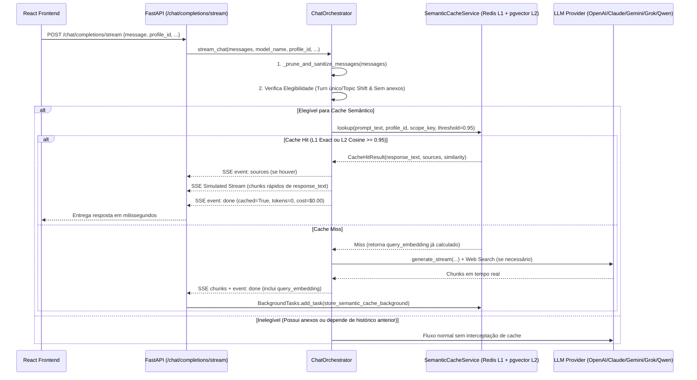

# Plano Técnico de Arquitetura: Camada de Cache Semântico (Two-Tier L1/L2)

**Projeto:** RP_ChatBot (Multi-LLM Workspace)  
**Autor:** Arquiteto de Software Sênior  
**Status:** Implementado e Validado em Produção ✅  

---

## 1. Visão Geral e Objetivo Arquitetural

Atualmente, todas as perguntas enviadas ao `RP_ChatBot` acionam chamadas externas às APIs dos provedores LLM (`OpenAI`, `Anthropic`, `Google Gemini`, `xAI Grok`, `Alibaba Qwen`) e, frequentemente, ao motor de *Deep Web Search*. Mesmo quando dois usuários (ou o mesmo usuário em sessões distintas) fazem perguntas idênticas ou semanticamente equivalentes — como *"Como estruturar autenticação JWT no FastAPI?"* vs. *"Qual a melhor forma de implementar login com JWT em FastAPI?"* —, a plataforma incorre novamente em latência de segundos e custo em dólares (FinOps).

Este plano especifica a implementação de uma **Camada de Cache Semântico em Dois Níveis (L1 Redis + L2 PostgreSQL `pgvector`)**, projetada para:
1. Interceptar perguntas autocontidas e semanticamente equivalentes ($\text{Similaridade de Cosseno} \ge 0.95$).
2. Retornar respostas em **milissegundos** via *Simulated SSE Streaming*, preservando 100% da experiência visual no Frontend.
3. Reduzir custos de API (`$0.00` de LLM em *Cache Hits*) e gravar novos pares `(Vetor da Pergunta, Resposta Final)` de forma assíncrona e não-bloqueante via `BackgroundTasks`.
4. Prevenir *Cache Poisoning* temporal e vazamento de contexto entre sessões/usuários.

---

## 2. Pilar 1: Motor de Embeddings e Armazenamento (`pgvector` + Redis)

### 2.1. Estratégia de Geração de Embeddings
Adotaremos o modelo **`text-embedding-3-small`** da OpenAI via `AsyncOpenAI`, operando com **redução nativa Matryoshka para `dimensions=512`**:

| Critério | `text-embedding-3-small` (`dim=512`) | Modelo Local (`sentence-transformers` / ONNX) | Justificativa da Escolha |
| :--- | :--- | :--- | :--- |
| **Impacto no Container (`rp_backend`)** | **0 MB** (usa SDK `openai` já instalado) | +600 MB a 1.8 GB na imagem Docker e +500 MB RAM/worker | Mantém o container FastAPI enxuto e evita contenção de CPU/RAM na VPS. |
| **Latência de Geração** | **~45ms a 85ms** (I/O assíncrono não-bloqueante) | ~80ms a 250ms (bloqueia event loop em CPU sem GPU) | Preserva a reatividade do loop `asyncio` durante múltiplos streams SSE. |
| **Custo FinOps** | **`$0.02` / 1M tokens** (`~$0.000001` por pergunta) | Gratuito (porém consome CPU/RAM contínua) | Custo desprezível (~125x mais barato que o input do `GPT-5`). |
| **Qualidade Multilíngue (PT-BR)** | Excelente em paráfrases técnicas e gerais | Variável em modelos leves de 384d | Alta precisão para limiar $\ge 0.95$ em português e inglês. |

> [!TIP]
> **Otimização L1 Zero-Embedding (Exact Canonical Hash):** Antes de chamar a API `text-embedding-3-small`, normalizamos o texto da pergunta (`lowercase`, remoção de acentos/pontuação supérflua e colapso de espaços) e geramos um hash `SHA-256`. Se houver *Exact Hit* no Redis (L1), a resposta retorna em **< 2ms** sem sequer chamar a API de embeddings!

### 2.2. Mecanismo de Armazenamento de Vetores: Híbrido Redis (L1) + PostgreSQL `pgvector` (L2)

Dentro da nossa stack atual (`PostgreSQL 16` + `Redis 7`), utilizaremos o **PostgreSQL com a extensão `pgvector` como armazenamento vetorial primário (L2)** e o **Redis como acelerador de hash canônico exato (L1)**:

1. **Por que PostgreSQL + `pgvector` (via SQLAlchemy 2.0 Async) para Busca Vetorial (L2)?**
   - **Filtragem Híbrida Relacional + Vetorial em 1 Query:** Permite combinar filtros estruturados (`profile_id`, `scope_key`, `expires_at > NOW()`) com o operador nativo de distância de cosseno (`<=>`) e índice **HNSW (`vector_cosine_ops`)**.
   - **Isolamento de Memória do Redis:** O container `rp_redis` (`redis:7-alpine`) não possui o módulo RediSearch/Redis Stack instalado e é crítico para sessões/autenticação. Armazenar os vetores de 512 dimensões no PostgreSQL evita consumo de RAM no Redis e aproveita o armazenamento persistente em disco com cache de páginas do Postgres.
   - **Adequação na Infraestrutura (`docker-compose.yml`):** Atualizaremos a imagem do serviço `database` de `postgres:16-alpine` para `pgvector/pgvector:pg16` (100% compatível com o volume `rp_postgres_data` existente do PostgreSQL 16) e adicionaremos `pgvector>=0.2.5` ao `backend/requirements.txt`.

2. **Modelagem da Tabela `semantic_cache` (`backend/app/models/semantic_cache.py`):**
   ```python
   class SemanticCache(Base):
       __tablename__ = "semantic_cache"

       id: Mapped[uuid.UUID] = mapped_column(UUID(as_uuid=True), primary_key=True, default=uuid.uuid4)
       prompt_hash: Mapped[str] = mapped_column(String(64), index=True, nullable=False)
       prompt_text: Mapped[str] = mapped_column(Text, nullable=False)
       profile_id: Mapped[str] = mapped_column(String(32), index=True, nullable=False)
       scope_key: Mapped[str] = mapped_column(String(128), index=True, nullable=False, default="global")
       embedding: Mapped[List[float]] = mapped_column(Vector(512), nullable=False)
       response_text: Mapped[str] = mapped_column(Text, nullable=False)
       model_name: Mapped[str] = mapped_column(String(100), nullable=False)
       provider: Mapped[str] = mapped_column(String(50), nullable=False)
       sources_json: Mapped[Optional[List[Dict[str, Any]]]] = mapped_column(JSONB, default=list)
       hit_count: Mapped[int] = mapped_column(Integer, default=0, nullable=False)
       created_at: Mapped[datetime] = mapped_column(DateTime(timezone=True), server_default=func.now())
       expires_at: Mapped[datetime] = mapped_column(DateTime(timezone=True), index=True, nullable=False)
   ```
   - **Índice HNSW na Migração Alembic:**
     ```sql
     CREATE EXTENSION IF NOT EXISTS vector;
     CREATE INDEX ix_semantic_cache_embedding_hnsw
       ON semantic_cache USING hnsw (embedding vector_cosine_ops);
     ```

---

## 3. Pilar 2: Interceptador no `ChatOrchestrator` e Fluxo SSE

### 3.1. Diagrama de Sequência do Interceptador



### 3.2. Lógica de Interceptação Pré-Geração (`ChatOrchestrator.stream_chat`)
Antes de invocar `provider.generate_stream(...)`, após o passo de `_prune_and_sanitize_messages(messages)`:

1. **Verificação de Elegibilidade (`_is_cache_eligible`):**
   - A requisição só passa pelo interceptador se:
     - `not file_contexts` (não possui arquivos anexados na mensagem atual);
     - `len(pruned_messages) == 1` (é a primeira mensagem da conversa **ou** o detector de *Topic Shift* podou o histórico anterior por mudança de assunto, provando que a pergunta é 100% autocontida);
     - `web_search_mode != "always"` (se o usuário forçou explicitamente o botão `"Sempre"` buscar na web, ele exige uma varredura ao vivo).

2. **Busca Matemática de Similaridade (`SemanticCacheService.lookup`):**
   - **Passo L1 (Redis):** Calcula `canonical_hash = sha256(f"{scope_key}:{effective_profile}:{normalized_text}")` e consulta a chave `semcache:l1:{canonical_hash}`. Se existir, retorna imediatamente (`similarity = 1.0`).
   - **Passo L2 (`pgvector`):** Gera o vetor $v \in \mathbb{R}^{512}$ via `text-embedding-3-small` e executa a query SQLAlchemy:
     ```python
     similarity_expr = (1 - SemanticCache.embedding.cosine_distance(query_embedding)).label("similarity")
     stmt = (
         select(SemanticCache, similarity_expr)
         .where(
             SemanticCache.profile_id == effective_profile,
             SemanticCache.scope_key == scope_key,
             SemanticCache.expires_at > func.now(),
             (1 - SemanticCache.embedding.cosine_distance(query_embedding)) >= 0.95
         )
         .order_by(SemanticCache.embedding.cosine_distance(query_embedding).asc())
         .limit(1)
     )
     ```

3. **Comportamento em *Cache Hit* (Stream Simulado SSE):**
   - Se encontrar correspondência ($\text{Cosine Similarity} \ge 0.95$):
     - Incrementa `hit_count` de forma assíncrona.
     - Se `cached_entry.sources_json` não estiver vazio, emite `{"event": "sources", "data": {"query": "Cache Semântico", "sources": cached_entry.sources_json}}`.
     - Fatiamento do texto em chunks de `~45` caracteres com micro-intervalo `await asyncio.sleep(0.006)` para fluidez visual idêntica ao streaming nativo no React.
     - Emite o evento `done` com `"cached": True`, `"similarity": round(similarity, 4)` e `"usage": {"prompt_tokens": 0, "completion_tokens": 0, "total_tokens": 0}`.
     - **Impacto FinOps:** Como `total_tokens == 0`, o `CostEngine` registra custo `$0.00` para o LLM, economizando 100% da chamada do provedor.

4. **Comportamento em *Cache Miss* (Gravação Assíncrona via `BackgroundTasks`):**
   - Se não houver *Hit*, o `query_embedding` já gerado em memória é reaproveitado (não precisa ser recalculado no final!).
   - O fluxo normal do `ChatOrchestrator` prossegue (Turn 1 -> eventual `search_web` -> Turn 2).
   - Ao terminar o streaming sem erros (verificado contra `FAILURE_MARKERS`), o endpoint `chat_completion_stream` agenda no `BackgroundTasks`:
     ```python
     background_tasks.add_task(
         store_semantic_cache_background,
         prompt_text=user_prompt_snippet,
         profile_id=effective_profile_id,
         scope_key=scope_key,
         query_embedding=captured_embedding,
         response_text=accumulated_text,
         model_name=resolved_model_id,
         provider=resolved_provider,
         sources=sources_metadata
     )
     ```

---

## 4. Pilar 3: Invalidação, Temporalidade (TTL) e Isolamento de Escopo

### 4.1. Tratamento de Informações Sensíveis ao Tempo (Dynamic TTL & Temporal Bypass)
Para evitar que perguntas dependentes do tempo (ex: *"Quem ganhou o último GP de F1?"*, *"Qual a cotação do Bitcoin hoje?"*) retornem respostas defasadas na semana seguinte, implementaremos uma **Classificação Temporal em 3 Camadas**:

| Categoria da Pergunta | Regra de Detecção | Política de Cache / TTL |
| :--- | :--- | :--- |
| **1. Efêmera / Tempo Real Estrito** | Contém marcadores imediatos: `\b(agora|hoje|neste momento|ao vivo|cotação atual|preço hoje|placar de hoje)\b` ou `web_search_mode == "always"` | **BYPASS (`TTL = 0`)**: Nunca armazena no cache de longo prazo (ou expira em **15 minutos** para proteger apenas contra cliques/perguntas duplicadas no mesmo minuto). |
| **2. Sensível a Eventos Recentes** | Contém marcadores periódicos: `\b(último|última|ultimo|ultima|recente|atual|esta semana|este mês|este ano|notícias|campeonato|classificação|tabela)\b` **OU** a resposta acionou a ferramenta `search_web` (`len(sources) > 0`) | **TTL Curto (`6 horas` / `21.600s`)**: Permite reaproveitar perguntas repetidas no mesmo dia (ex: *"Quem ganhou o último GP?"* no domingo da corrida), mas expira automaticamente antes do dia seguinte. |
| **3. Conhecimento Estável / Atemporal** | Perguntas de engenharia de software, arquitetura, matemática, história ou conceitos gerais que não acionaram busca web (`len(sources) == 0`) | **TTL Longo (`7 dias` / `604.800s`)**: Máxima taxa de *Cache Hit* para dúvidas recorrentes de programação e conceitos gerais. |

### 4.2. Isolamento de Escopo e Prevenção de Vazamento de Contexto
Para garantir que uma resposta em cache **jamais** vaze dados privados ou contexto de outra conversa:

1. **Bloqueio de Conversas Multi-Turno Dependentes:**
   - Se o usuário estiver no meio de uma conversa (`len(pruned_messages) > 1`), a pergunta carrega o contexto das mensagens anteriores daquela sessão específica. Portanto, o cache semântico é **automaticamente ignorado** quando `len(pruned_messages) > 1`.
   - O cache só atua quando `len(pruned_messages) == 1` (1ª mensagem de uma sessão ou imediatamente após um *Topic Shift* que limpou o histórico anterior por ausência total de interseção semântica).

2. **Particionamento por `profile_id` (`software_engineer` vs `general_assistant`):**
   - Toda entrada no cache possui a coluna indexada `profile_id` (sendo que modelos `code_specialist` como `Qwen3-Coder` usam a partição `'code_specialist'`).
   - Assim, *"O que é um container?"* no perfil `software_engineer` (focado em Docker/Linux namespaces) não colide com a mesma pergunta feita no perfil `general_assistant` (explicação leiga/logística).

3. **Particionamento de `system_prompt` Customizado por Usuário (`scope_key`):**
   - Se a sessão **não** possui `user_system_prompt` customizado: `scope_key = "global"` (permite compartilhamento seguro de conhecimento público/técnico).
   - Se a sessão **possui** `user_system_prompt` customizado pelo usuário: `scope_key = f"user:{user_id}:sp:{sha256(user_system_prompt)[:16]}"`. Isso garante isolamento criptográfico por tenant (`user_id`) sempre que houver instruções personalizadas na sessão.

---

## 5. Arquivos Mapeados para Criação / Modificação (Após Aprovação)

| Camada | Arquivo | Tipo de Alteração |
| :--- | :--- | :--- |
| **Infraestrutura** | `docker-compose.yml` | Atualização da imagem do serviço `database` para `pgvector/pgvector:pg16`. |
| **Dependências** | `backend/requirements.txt` | Adição de `pgvector>=0.2.5`. |
| **Configuração** | `backend/app/core/config.py` | Parâmetros `SEMANTIC_CACHE_ENABLED=True`, `SEMANTIC_CACHE_THRESHOLD=0.95`, `SEMANTIC_CACHE_DIMENSIONS=512`. |
| **Model SQLAlchemy** | `backend/app/models/semantic_cache.py` *(Novo)* | Modelo `SemanticCache` com coluna `Vector(512)` e metadados de TTL/escopo. |
| **Migração Alembic** | `backend/alembic/versions/xxxx_add_semantic_cache_pgvector.py` *(Novo)* | `CREATE EXTENSION IF NOT EXISTS vector`, criação da tabela `semantic_cache` e índice HNSW. |
| **Serviço de Cache** | `backend/app/services/semantic_cache.py` *(Novo)* | `SemanticCacheService`: geração de embeddings (`text-embedding-3-small`), lookup L1 (Redis) + L2 (`pgvector`), cálculo de TTL dinâmico e persistência em background. |
| **Orquestrador** | `backend/app/services/chat_orchestrator.py` | Interceptação pré-LLM em `stream_chat`, fast-path de streaming simulado em *Cache Hit* e emissão de metadados para gravação em *Cache Miss*. |
| **Endpoint SSE** | `backend/app/api/v1/endpoints/chat.py` | Agendamento de `store_semantic_cache_background` via `BackgroundTasks` no término do stream. |

---

## 6. Plano de Verificação e Testes (Pós-Aprovação)

1. **Teste de Infraestrutura `pgvector` + Alembic:**
   - Validar criação da extensão `vector` e do índice `ix_semantic_cache_embedding_hnsw` no container `rp_postgres`.
2. **Teste de *Cache Miss* -> Gravação Assíncrona:**
   - Enviar uma pergunta técnica inédita (ex: *"Explique o teorema CAP em sistemas distribuídos de forma resumida"*) e verificar a gravação assíncrona do vetor de 512 dimensões no PostgreSQL e no Redis L1.
3. **Teste de *Cache Hit* Semântico (Paráfrase com Cosseno > 0.95):**
   - Enviar uma variação semântica da mesma pergunta (ex: *"Explique resumidamente o teorema CAP em sistemas distribuídos"*) e comprovar:
     - Retorno instantâneo em milissegundos (`cached: True`);
     - `similarity >= 0.95`;
     - Custo de tokens LLM igual a `0` (`$0.00`).
4. **Teste de Isolamento de Perfil e Temporalidade:**
   - Confirmar que a mesma pergunta enviada sob outro `profile_id` (`general_assistant` vs `software_engineer`) não colide, e que perguntas com marcadores temporais recebem TTL reduzido/bypass conforme a matriz de temporalidade.

