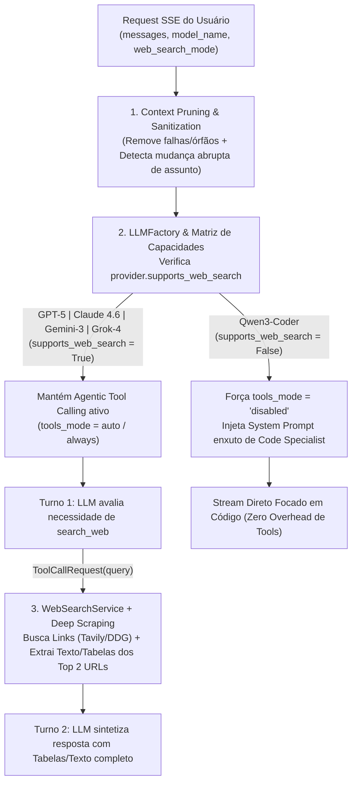

# 📋 Plano Arquitetural — Especialização por Provedor, Scraping Profundo e Poda de Contexto

**Projeto:** `RP_ChatBot`  
**Arquivos Alvo:**
- [`backend/requirements.txt`](file:///c:/Users/rpapl/.gemini/antigravity-ide/scratch/rp_chatbot_ui/backend/requirements.txt) *(Inclusão de `beautifulsoup4` para parsing HTML/Tabelas)*
- [`backend/app/services/llm/base.py`](file:///c:/Users/rpapl/.gemini/antigravity-ide/scratch/rp_chatbot_ui/backend/app/services/llm/base.py)
- [`backend/app/services/llm/qwen_provider.py`](file:///c:/Users/rpapl/.gemini/antigravity-ide/scratch/rp_chatbot_ui/backend/app/services/llm/qwen_provider.py)
- [`backend/app/services/llm/factory.py`](file:///c:/Users/rpapl/.gemini/antigravity-ide/scratch/rp_chatbot_ui/backend/app/services/llm/factory.py)
- [`backend/app/services/web_search.py`](file:///c:/Users/rpapl/.gemini/antigravity-ide/scratch/rp_chatbot_ui/backend/app/services/web_search.py)
- [`backend/app/services/chat_orchestrator.py`](file:///c:/Users/rpapl/.gemini/antigravity-ide/scratch/rp_chatbot_ui/backend/app/services/chat_orchestrator.py)

**Objetivo:** Evoluir a orquestração do `RP_ChatBot` de um modelo genérico uniforme para um **Design Específico por Provedor**, combinando:
1. **Roteamento Assimétrico de Ferramentas:** Ativação de `search_web` apenas em LLMs generalistas (`GPT-5`, `Claude 4.6`, `Gemini-3`, `Grok-4`) e bloqueio programático (`tools_mode="disabled"`) em modelos especialistas em código (`Qwen3-Coder`).
2. **Scraping Profundo (Full Page & Table Extraction):** Extração assíncrona do conteúdo real e tabelas HTML convertidas para Markdown das 2 principais páginas retornadas pela busca web, eliminando a "fome de dados" causada por snippets truncados.
3. **Poda e Higienização de Contexto (Context Pruning):** Remoção automática de blocos órfãos/respostas com falha e isolamento de histórico quando o usuário muda abruptamente de assunto na mesma sessão.

**Status:** Aguardando Aprovação Técnica para Execução

---

## 1. Visão Geral da Nova Arquitetura de Orquestração



---

## 2. Detalhamento Técnico dos 3 Pilares

### 2.1. Pilar 1: Roteamento Assimétrico de Ferramentas (Tool Disabling)

Atualmente, `BaseLLMProvider` trata todos os provedores como se tivessem o mesmo perfil operacional. Para especializar o comportamento:

1. **Matriz Declarativa de Capacidades em [`backend/app/services/llm/base.py`](file:///c:/Users/rpapl/.gemini/antigravity-ide/scratch/rp_chatbot_ui/backend/app/services/llm/base.py):**
   Adicionaremos dois atributos de classe em `BaseLLMProvider`:
   ```python
   class BaseLLMProvider(ABC):
       provider_name: str
       default_model: str
       supports_web_search: bool = True
       specialization: str = "generalist"  # "generalist" | "code_specialist"
   ```

2. **Configuração dos Provedores:**
   - **Modelos Generalistas (`OpenAIProvider`, `AnthropicProvider`, `GeminiProvider`, `XAIProvider`):**
     Herdam `supports_web_search = True` e `specialization = "generalist"`, mantendo o suporte integral ao `search_web`.
   - **Modelo Especialista em Código ([`QwenProvider`](file:///c:/Users/rpapl/.gemini/antigravity-ide/scratch/rp_chatbot_ui/backend/app/services/llm/qwen_provider.py) — `Qwen3-Coder`):**
     Define explicitamente:
     ```python
     class QwenProvider(BaseLLMProvider):
         provider_name = "qwen"
         default_model = "qwen3.5-plus"
         supports_web_search = False
         specialization = "code_specialist"
     ```
     Além disso, dentro de `QwenProvider.generate_stream()`, o parâmetro `tools_mode` será sempre sobrescrito para `"disabled"` como dupla garantia arquitetural.

3. **Bloqueio Programático e Otimização de Prompt no [`ChatOrchestrator`](file:///c:/Users/rpapl/.gemini/antigravity-ide/scratch/rp_chatbot_ui/backend/app/services/chat_orchestrator.py):**
   - Logo após resolver o provedor via `provider, target_model_id = LLMFactory.resolve(model_name)`, o orquestrador calcula:
     ```python
     effective_tools_mode = web_search_mode if provider.supports_web_search else "disabled"
     ```
   - Na montagem do `_build_effective_system_prompt()`, se `provider.supports_web_search` for `False`, a diretriz sobre `search_web` **não é injetada**, economizando tokens de entrada e evitando que o modelo especialista em código tente invocar ferramentas ou alucine pesquisas externas.

---

### 2.2. Pilar 2: Scraping Profundo Assíncrono (Full Page & Table Extraction)

O motivo pelo qual LLMs às vezes confundem dados de tabelas (como pódios de corridas de F1 ou comparativos técnicos) é que o motor de busca retorna apenas um *snippet* de ~200 caracteres truncado no meio da frase.

Para entregar **dados estruturados reais** à LLM no `tool_response`:

1. **Dependência (`backend/requirements.txt`):**
   Adicionaremos `beautifulsoup4>=4.12.0` (que trabalhará em conjunto com o parser rápido `lxml` e o cliente assíncrono `httpx` já presentes no projeto).

2. **Extração Profunda Paralela dos Top 2 Resultados em [`backend/app/services/web_search.py`](file:///c:/Users/rpapl/.gemini/antigravity-ide/scratch/rp_chatbot_ui/backend/app/services/web_search.py):**
   Após obter a lista inicial de 5 resultados do Tavily ou DuckDuckGo em `search(query)`:
   - Se o Tavily for utilizado, ativaremos `include_raw_content=True` na chamada da API.
   - Para os **2 primeiros resultados (`TOP_SCRAPE_COUNT = 2`)** que ainda não possuam conteúdo completo, o `WebSearchService` disparará requisições HTTP assíncronas concorrentes (`asyncio.gather`) via `httpx.AsyncClient(timeout=5.0, follow_redirects=True)` com headers de navegador padrão (`User-Agent` limpo).
   - **Parser Inteligente de HTML e Tabelas (`_extract_structured_page_content`):**
     Executado via `asyncio.to_thread` para não bloquear o Event Loop:
     - Remove tags de layout irrelevantes (`script`, `style`, `nav`, `footer`, `header`, `aside`, `noscript`, `svg`, `form`, `iframe`).
     - **Preservação de Tabelas (`<table>` -> Markdown Table):** Percorre as tabelas HTML da página e converte cada linha (`<tr>` com `<th>`/`<td>`) para notação de tabela Markdown (`| Coluna 1 | Coluna 2 | Coluna 3 |`). Isso garante que cada linha de resultado (ex: `| GP dos EUA | 1º Charles Leclerc | 2º Kimi Antonelli |`) permaneça rigidamente agrupada!
     - Extrai os cabeçalhos (`h1`-`h3`), listas (`li`) e parágrafos (`p`) principais até um limite seguro de **`4.000` caracteres por página** (`page_content`).

3. **Enriquecimento do `format_search_context(results)`:**
   O texto enviado no `tool_response` para a LLM passará a conter:
   - Para os **Top 2 resultados**: Título, URL, Snippet original **+ o bloco `Conteúdo Extraído da Página (Texto & Tabelas)`**.
   - Para os demais resultados (`[3]` a `[5]`): Título, URL e Snippet conciso como referência complementar.

---

### 2.3. Pilar 3: Poda e Higienização de Contexto (Context Pruning)

Para impedir que conversas anteriores na mesma sessão contaminem uma nova pergunta sobre outro assunto ou carreguem falhas passadas, implementaremos o método `_prune_and_sanitize_messages(messages: List[Dict[str, str]]) -> List[Dict[str, str]]` no [`ChatOrchestrator`](file:///c:/Users/rpapl/.gemini/antigravity-ide/scratch/rp_chatbot_ui/backend/app/services/chat_orchestrator.py):

1. **Etapa A — Higienização de Blocos Órfãos e Respostas Inválidas/Falhas:**
   - Varre o histórico recebido do banco e descarta mensagens de `assistant` vazias, interrompidas (`*(Geração interrompida pelo usuário)*`), ou que contenham erros de API/ferramentas (`⚠️ *Erro`, `[OpenAI Error:`, `[Anthropic Error:`, `[xAI Error:`, `[Qwen Error:`, `[Erro de Integração`), bem como respostas onde o modelo declarou incapacidade temporária de busca (`Nenhum resultado encontrado na web`).
   - Se duas mensagens consecutivas do mesmo `role` (`user` -> `user`) restarem após a remoção de uma falha órfã do `assistant`, elas são mescladas ou apenas a mais recente é mantida, garantindo alternância estrita `user` / `assistant` (exigida por Anthropic e Gemini).

2. **Etapa B — Detecção de Mudança Abrupta de Assunto (Topic Shift Pruning):**
   - Extrai o conjunto de tokens semânticos relevantes (palavras `>= 4` letras, excluindo *stopwords* em português/inglês) da **última mensagem do usuário** (`current_tokens`) e compara com os tokens das mensagens anteriores da sessão (`history_tokens`).
   - Verifica se a última mensagem contém conectivos de continuidade explícita (ex: *"e sobre"*, *"nesse código"*, *"explique melhor"*, *"continue"*, *"refatore"*, *"acima"*, *"anterior"*).
   - **Regra de Poda por Mudança de Tópico:** Se a mensagem atual **não** possui conectivos de continuidade e a interseção vocabular com o histórico anterior for nula (`len(current_tokens & history_tokens) == 0`, como quando o usuário estava falando de *Docker/PostgreSQL* e de repente pergunta *"Quem ganhou o último GP de F1?"*), o orquestrador poda o histórico antigo enviado à LLM, mantendo apenas o contexto imediato (ou exclusivamente a nova pergunta), eliminando 100% do *context leakage*!

3. **Etapa C — Janela Deslizante de Segurança (Sliding Window Cap):**
   - Mesmo em conversas contínuas sobre o mesmo tema, limita o envio às últimas `8` mensagens (`4` pares `user`/`assistant`) e comprime blocos gigantes de anexos antigos, preservando o histórico completo intacto no PostgreSQL para visualização na UI.

---

## 3. Plano de Execução e Validação Pós-Aprovação

Após sua aprovação formal deste `plano_especializacao_llms.md`:
1. Adicionaremos `beautifulsoup4>=4.12.0` ao [`backend/requirements.txt`](file:///c:/Users/rpapl/.gemini/antigravity-ide/scratch/rp_chatbot_ui/backend/requirements.txt).
2. Atualizaremos [`backend/app/services/llm/base.py`](file:///c:/Users/rpapl/.gemini/antigravity-ide/scratch/rp_chatbot_ui/backend/app/services/llm/base.py) e [`backend/app/services/llm/qwen_provider.py`](file:///c:/Users/rpapl/.gemini/antigravity-ide/scratch/rp_chatbot_ui/backend/app/services/llm/qwen_provider.py) com o roteamento assimétrico de capacidades (`supports_web_search = False` para `Qwen3-Coder`).
3. Implementaremos o **Scraping Profundo Assíncrono** (com extração de tabelas HTML -> Markdown dos 2 primeiros resultados) em [`backend/app/services/web_search.py`](file:///c:/Users/rpapl/.gemini/antigravity-ide/scratch/rp_chatbot_ui/backend/app/services/web_search.py).
4. Implementaremos o pipeline de **Context Pruning & Sanitization** e o bloqueio de tools por provedor em [`backend/app/services/chat_orchestrator.py`](file:///c:/Users/rpapl/.gemini/antigravity-ide/scratch/rp_chatbot_ui/backend/app/services/chat_orchestrator.py).
5. Faremos o rebuild de `rp_backend` e executaremos testes automatizados validando:
   - `Qwen3-Coder` ignorando `web_search_mode="always"` e operando com `tools_mode="disabled"`.
   - `WebSearchService` extraindo conteúdo completo e tabelas das 2 principais URLs.
   - `ChatOrchestrator` podando histórico contaminado após mudança abrupta de assunto.

