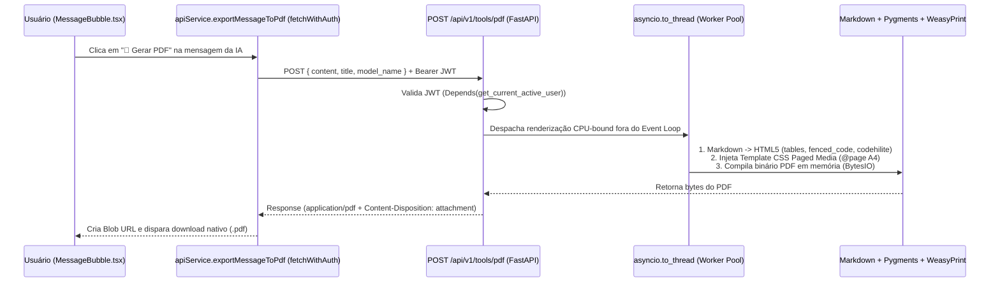

# 📋 Plano Arquitetural — Gerador de PDF Server-Side (FastAPI + WeasyPrint + React)

**Projeto:** `RP_ChatBot`  
**Objetivo:** Implementar uma ferramenta de exportação de respostas do assistente para documentos **PDF profissionais** renderizados no servidor (Server-Side Rendering via `WeasyPrint` + `Markdown`), com suporte completo a tabelas GFM, blocos de código formatados com quebra automática de linha, paginação A4 e download nativo na interface React.  
**Status:** Aguardando Aprovação Técnica para Execução

---

## 1. Visão Geral da Arquitetura



> [!IMPORTANT]
> **Isolamento Assíncrono (`asyncio.to_thread`):** A renderização tipográfica e de layout do `WeasyPrint` (Pango + Cairo) é uma operação síncrona e intensiva em CPU. Ao executá-la dentro de `asyncio.to_thread()`, garantimos que o Event Loop principal do FastAPI permaneça 100% livre para processar streams SSE simultâneos sem latência.

---

## 2. Detalhamento Técnico dos 4 Pilares

### 2.1. Pilar 1: Dependências do Servidor ([`backend/Dockerfile`](file:///c:/Users/rpapl/.gemini/antigravity-ide/scratch/rp_chatbot_ui/backend/Dockerfile) e [`backend/requirements.txt`](file:///c:/Users/rpapl/.gemini/antigravity-ide/scratch/rp_chatbot_ui/backend/requirements.txt))

1. **Bibliotecas Nativas do Sistema Operacional (`backend/Dockerfile`):**
   O container base `python:3.11-slim` (Debian) requer as bibliotecas gráficas da pilha **Pango/Cairo/GDK-PixBuf** e pacotes de fontes TrueType para que o `WeasyPrint` renderize textos acentuados (UTF-8) e blocos de código monoespaçados com perfeição:
   ```dockerfile
   RUN apt-get update && apt-get install -y --no-install-recommends \
       build-essential \
       libpoppler-cpp-dev \
       libmagic1 \
       libpango-1.0-0 \
       libpangocairo-1.0-0 \
       libpangoft2-1.0-0 \
       libcairo2 \
       libgdk-pixbuf-2.0-0 \
       libffi-dev \
       shared-mime-info \
       fonts-liberation \
       fonts-dejavu-core \
       curl \
       && rm -rf /var/lib/apt/lists/*
   ```

2. **Pacotes Python (`backend/requirements.txt`):**
   ```text
   # Server-Side PDF Generation
   weasyprint>=61.0
   markdown>=3.6
   pygments>=2.17.0
   ```
   - `markdown`: Converte a sintaxe Markdown da resposta da IA (incluindo extensões `extra`, `tables`, `fenced_code`, `sane_lists` e `nl2br`) para HTML estruturado.
   - `pygments`: Utilizado pela extensão `codehilite` do `markdown` para aplicar *syntax highlighting* diretamente nos blocos de código exportados para o PDF.
   - `weasyprint`: Motor CSS Paged Media que converte o documento HTML+CSS em um arquivo PDF vetorial paginado.

---

### 2.2. Pilar 2: Serviço e Endpoint Backend (`backend/app/services/pdf_generator.py` e `backend/app/api/v1/endpoints/tools.py`)

1. **Serviço Especializado (`backend/app/services/pdf_generator.py`):**
   Criaremos a classe `PDFGeneratorService` responsável por:
   - Converter o texto Markdown em HTML semântico utilizando `markdown.markdown(...)` com as extensões `['extra', 'codehilite', 'sane_lists', 'toc']`.
   - Envolver o HTML gerado em um documento HTML5 completo com cabeçalho institucional (`RP_ChatBot`, modelo utilizado e timestamp) e folha de estilo CSS embutida.
   - Executar `weasyprint.HTML(string=full_html).write_pdf()` dentro de `await asyncio.to_thread(...)`, retornando os `bytes` do PDF diretamente em memória (sem necessidade de gravar arquivos temporários em disco).

2. **Endpoint Protegido (`backend/app/api/v1/endpoints/tools.py`):**
   - **Rota:** `POST /api/v1/tools/pdf`
   - **Proteção:** `current_user: User = Depends(get_current_active_user)` (garantindo que apenas usuários autenticados na Whitelist possam acionar o motor de renderização).
   - **Schema de Entrada (`PDFExportRequest`):**
     ```python
     class PDFExportRequest(BaseModel):
         content: str = Field(..., min_length=1, description="Conteúdo em Markdown da mensagem")
         title: Optional[str] = Field(default="Documento Técnico - RP_ChatBot", max_length=160)
         model_name: Optional[str] = Field(default=None, max_length=100)
     ```
   - **Resposta HTTP:**
     Retorna `Response(content=pdf_bytes, media_type="application/pdf", headers={"Content-Disposition": f'attachment; filename="{filename}"'})`.
   - **Registro no Router Principal ([`backend/app/api/v1/router.py`](file:///c:/Users/rpapl/.gemini/antigravity-ide/scratch/rp_chatbot_ui/backend/app/api/v1/router.py)):**
     Inclusão de `api_router.include_router(tools.router)`.

---

### 2.3. Pilar 3: Estilização Dinâmica (CSS Paged Media Profissional)

O template CSS injetado pelo `PDFGeneratorService` foi desenhado especificamente para leitura técnica e impressão em folha **A4**:

- **Configuração de Página e Numeração Automática (`@page`):**
  - Tamanho `A4` com margens equilibradas (`20mm 18mm 22mm 18mm`).
  - Rodapé automático via CSS `@bottom-left` (*"RP_ChatBot • Multi-LLM Technical Document"*) e `@bottom-right` (*"Página X de Y"* via `counter(page)` / `counter(pages)`).
- **Tipografia e Hierarquia Visual:**
  - Família principal: `'Liberation Sans', 'DejaVu Sans', Arial, sans-serif`, cor `#1e293b` (Slate 800) sobre fundo branco para máxima legibilidade e economia de tinta na impressão.
  - Cabeçalho de documento com título, badge do modelo LLM gerador e data/hora.
- **Blocos de Código (`pre`, `code`) à Prova de Corte:**
  - Família monoespaçada: `'DejaVu Sans Mono', 'Liberation Mono', monospace`.
  - Fundo `#f8fafc`, borda `#e2e8f0`, `border-radius: 6px`, `padding: 10px 12px`.
  - Regra crítica `white-space: pre-wrap; word-wrap: break-word; overflow-wrap: anywhere;` para garantir que linhas longas de código **nunca** ultrapassem a margem direita do PDF.
  - `page-break-inside: avoid;` para evitar que pequenos trechos de código ou células de tabela sejam partidos ao meio na virada de página.
- **Tabelas GFM (`table`, `th`, `td`):**
  - `width: 100%; border-collapse: collapse;` com cabeçalho em `#f1f5f9`, bordas `#cbd5e1` e linhas alternadas suaves.

---

### 2.4. Pilar 4: Integração Frontend ([`frontend/src/services/api.ts`](file:///c:/Users/rpapl/.gemini/antigravity-ide/scratch/rp_chatbot_ui/frontend/src/services/api.ts) e [`frontend/src/components/chat/MessageBubble.tsx`](file:///c:/Users/rpapl/.gemini/antigravity-ide/scratch/rp_chatbot_ui/frontend/src/components/chat/MessageBubble.tsx))

1. **Cliente REST Autenticado ([`frontend/src/services/api.ts`](file:///c:/Users/rpapl/.gemini/antigravity-ide/scratch/rp_chatbot_ui/frontend/src/services/api.ts)):**
   Adicionaremos o método `generatePdf`:
   ```typescript
   async generatePdf(params: {
     content: string;
     title?: string;
     model_name?: string;
   }): Promise<Blob> {
     const res = await fetchWithAuth(`${API_BASE}/tools/pdf`, {
       method: 'POST',
       headers: { 'Content-Type': 'application/json' },
       body: JSON.stringify(params)
     });
     if (!res.ok) {
       const errText = await res.text();
       throw new Error(`Falha ao gerar PDF: ${errText}`);
     }
     return res.blob();
   }
   ```

2. **Botão de Ação `"📄 Gerar PDF"` ([`frontend/src/components/chat/MessageBubble.tsx`](file:///c:/Users/rpapl/.gemini/antigravity-ide/scratch/rp_chatbot_ui/frontend/src/components/chat/MessageBubble.tsx)):**
   - Adicionaremos o estado local `const [isGeneratingPdf, setIsGeneratingPdf] = useState(false);`.
   - Na barra de ações das mensagens do assistente (`!isUser && message.content && !message.isStreaming`), ao lado do botão de copiar, exibiremos o botão **"📄 Gerar PDF"** (utilizando os ícones `FileDown` e `Loader2` do `lucide-react`).
   - Ao ser clicado, `handleDownloadPdf` chama `apiService.generatePdf(...)`, cria um `ObjectURL` temporário a partir do `Blob` retornado, aciona um elemento `<a download="rp_chatbot_resposta_YYYYMMDD.pdf">` programaticamente e libera a memória com `URL.revokeObjectURL`.

---

## 3. Plano de Validação Pós-Aprovação

Assim que você autorizar a execução técnica:
1. Atualizaremos `backend/Dockerfile` e `backend/requirements.txt`.
2. Criaremos `backend/app/services/pdf_generator.py` e `backend/app/api/v1/endpoints/tools.py`, registrando a rota em `backend/app/api/v1/router.py`.
3. Atualizaremos `frontend/src/services/api.ts` e `frontend/src/components/chat/MessageBubble.tsx`.
4. Faremos o rebuild de `rp_backend` e `rp_frontend` no Docker (`docker compose up -d --build backend frontend`).
5. Executaremos um teste automatizado enviando um documento Markdown complexo (com tabelas, blocos de código Python/SQL e títulos) para `POST /api/v1/tools/pdf`, validando o cabeçalho mágico `%PDF-1.` e o tamanho do binário gerado.

