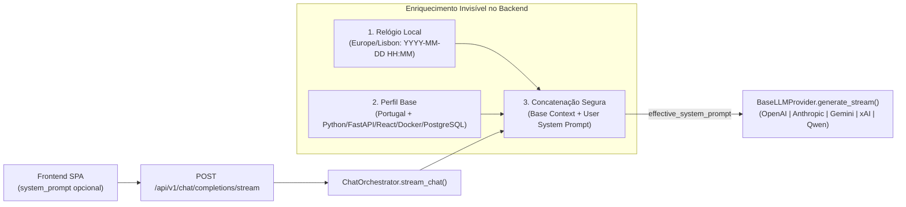

# 📋 Plano Arquitetural — Injeção Dinâmica de Contexto Temporal e Perfil de Engenharia

**Projeto:** `RP_ChatBot`  
**Componente Alvo:** [`backend/app/services/chat_orchestrator.py`](file:///c:/Users/rpapl/.gemini/antigravity-ide/scratch/rp_chatbot_ui/backend/app/services/chat_orchestrator.py)  
**Objetivo:** Dotar todos os 5 provedores de LLM (`OpenAI`, `Anthropic`, `Gemini`, `xAI`, `Qwen`) de consciência temporal exata em tempo de requisição e alinhamento nativo com o contexto geográfico (Portugal) e a stack tecnológica padrão do usuário (`Python`, `FastAPI`, `React`, `Docker`, `PostgreSQL`), preservando integralmente qualquer `system_prompt` customizado na interface.  
**Status:** Aguardando Aprovação Formal para Execução

---

## 1. Visão Geral da Solução Arquitetural

Atualmente, o método `ChatOrchestrator.stream_chat()` em [`backend/app/services/chat_orchestrator.py`](file:///c:/Users/rpapl/.gemini/antigravity-ide/scratch/rp_chatbot_ui/backend/app/services/chat_orchestrator.py#L18-L108) repassa o parâmetro `system_prompt` diretamente para `provider.generate_stream(...)`. Quando o usuário não define um `system_prompt` no modal de configurações da sessão, o valor chega como `None` ou string vazia, fazendo com que as LLMs:
1. Desconheçam a data e a hora exatas do momento da pergunta.
2. Não saibam que o usuário opera a partir de **Portugal** (fuso `Europe/Lisbon`, contexto europeu/RGPD, idioma e convenções).
3. Precisem que o usuário repita sua stack principal (`Python`, `FastAPI`, `React`, `Docker`, `PostgreSQL`) a cada nova sessão.

Ao centralizar essa injeção dentro do `ChatOrchestrator` (em tempo de *dispatch* para o provedor LLM), obtemos três vantagens:
- **Invisibilidade e Limpeza na UI/DB:** O campo `sessions.system_prompt` no PostgreSQL e o modal "Configurações da Conversa" no React continuam exibindo exclusivamente o que o usuário digitou (ou vazio por padrão), sem poluir a interface com blocos de metadados internos.
- **Propagação Universal Multi-LLM:** Como o `ChatOrchestrator` fica imediatamente acima da camada `BaseLLMProvider`, a string enriquecida `effective_system_prompt` é entregue automaticamente para **GPT-5**, **Claude 4.6**, **Gemini 3**, **Grok 4** e **Qwen3**.
- **Avaliação Dinâmica por Requisição:** O timestamp é calculado no exato instante de cada mensagem enviada (`datetime.now(ZoneInfo("Europe/Lisbon"))`), mantendo precisão de minutos mesmo em sessões que duram vários dias.



---

## 2. Detalhamento Técnico dos 3 Pilares

### 2.1. Pilar 1: Injeção Dinâmica de Tempo (`Europe/Lisbon`)
Como o container `rp_backend` (`python:3.11-slim`) roda com relógio de sistema em `UTC`, o uso de `datetime.now()` simples sem fuso horário causaria divergência de +1h no verão (WEST) em relação ao horário real em Portugal.

- Utilizaremos a biblioteca padrão `zoneinfo` do Python 3.11 (`from zoneinfo import ZoneInfo`) configurada para **`Europe/Lisbon`** (com fallback seguro para `timezone.utc` caso `tzdata` não esteja presente no ambiente).
- A cada chamada de `stream_chat()`, será capturado o timestamp atual formatado no padrão `YYYY-MM-DD HH:MM` (incluindo o dia da semana para facilitar raciocínio temporal relativo como *"ontem"*, *"próxima segunda-feira"* ou *"hoje"*):
  ```python
  now_pt = datetime.now(ZoneInfo("Europe/Lisbon"))
  formatted_time = now_pt.strftime("%Y-%m-%d %H:%M")
  # Ex: "System Info: A data e hora atuais são 2026-10-28 18:40 (Fuso horário: Europe/Lisbon - Portugal)."
  ```

---

### 2.2. Pilar 2: Injeção de Perfil Geográfico e Stack Base
Definiremos no `ChatOrchestrator` uma constante/template de contexto base invisível (`DEFAULT_DEVELOPER_CONTEXT`) que instrui o modelo de forma concisa, direta e sem desperdiçar tokens:

```python
BASE_DEVELOPER_PROFILE = (
    "Contexto Global do Usuário e Ambiente de Desenvolvimento:\n"
    "- Localização Geográfica: O usuário está desenvolvendo a partir de Portugal. "
    "Considere o contexto de Portugal/União Europeia para referências geográficas, fuso horário (Europe/Lisbon), "
    "moeda (Euro - €), normas técnicas e legislação (ex: RGPD).\n"
    "- Stack Tecnológica Padrão: A arquitetura padrão de projetos do usuário utiliza Python (3.11+), FastAPI, "
    "React (TypeScript, Vite, Tailwind CSS, Zustand), Docker (Docker Compose / Microsserviços) e "
    "PostgreSQL (SQLAlchemy 2.0 Async + Alembic). Salvo solicitação explícita em contrário, priorize "
    "exemplos, padrões arquiteturais e boas práticas alinhados a essa stack."
)
```

---

### 2.3. Pilar 3: Concatenação Segura com o `system_prompt` do Frontend
Criaremos o método auxiliar `_build_effective_system_prompt(self, user_system_prompt: Optional[str]) -> str` dentro de `ChatOrchestrator` em [`backend/app/services/chat_orchestrator.py`](file:///c:/Users/rpapl/.gemini/antigravity-ide/scratch/rp_chatbot_ui/backend/app/services/chat_orchestrator.py):

1. **Montagem do Bloco de Metadados Base:**
   Combina a linha `System Info: A data e hora atuais são YYYY-MM-DD HH:MM (Europe/Lisbon - Portugal).` com o `BASE_DEVELOPER_PROFILE`.
2. **Preservação Integral do `system_prompt` do Usuário:**
   - **Caso A (`user_system_prompt` vazio ou `None`):** Retorna apenas o bloco base (tempo dinâmico + perfil Portugal/Stack).
   - **Caso B (`user_system_prompt` preenchido pelo usuário na UI):** Acopla o bloco de metadados como **prefixo** de contexto ambiental e adiciona em seguida uma seção explícita `--- Instruções Específicas da Sessão (Definidas pelo Usuário) ---` contendo `user_system_prompt.strip()` sem qualquer truncamento ou alteração, garantindo que instruções customizadas do usuário tenham precedência comportamental caso especializem ou sobreponham a tarefa.

#### Estrutura Exata do Método Proposto em `backend/app/services/chat_orchestrator.py`
```python
from datetime import datetime, timezone
from zoneinfo import ZoneInfo, ZoneInfoNotFoundError

class ChatOrchestrator:
    BASE_DEVELOPER_PROFILE = (
        "Contexto Global do Usuário e Ambiente de Desenvolvimento:\n"
        "- Localização Geográfica: O usuário está desenvolvendo a partir de Portugal. "
        "Considere o contexto de Portugal/União Europeia para referências geográficas, fuso horário (Europe/Lisbon), "
        "moeda (Euro - €) e regulamentações (ex: RGPD).\n"
        "- Stack Tecnológica Padrão: A arquitetura padrão do usuário envolve Python, FastAPI, "
        "React, Docker e PostgreSQL. Salvo instrução explícita em contrário na conversa, "
        "direcione exemplos de código, arquiteturas e recomendações técnicas para essa stack."
    )

    def _build_effective_system_prompt(self, user_system_prompt: Optional[str] = None) -> str:
        """
        Injeta dinamicamente a data/hora local de Portugal e o perfil de stack padrão,
        preservando integralmente qualquer system_prompt personalizado vindo do Frontend.
        """
        try:
            tz_pt = ZoneInfo("Europe/Lisbon")
        except ZoneInfoNotFoundError:
            tz_pt = timezone.utc

        now_str = datetime.now(tz_pt).strftime("%Y-%m-%d %H:%M")
        time_info = f"System Info: A data e hora atuais são {now_str} (Fuso horário: Europe/Lisbon - Portugal)."

        base_context = f"{time_info}\n\n{self.BASE_DEVELOPER_PROFILE}"

        if user_system_prompt and user_system_prompt.strip():
            return (
                f"{base_context}\n\n"
                f"--- Instruções Personalizadas da Sessão (Prioritárias) ---\n"
                f"{user_system_prompt.strip()}"
            )

        return base_context
```

E no passo 5 de `stream_chat()` ([`backend/app/services/chat_orchestrator.py`](file:///c:/Users/rpapl/.gemini/antigravity-ide/scratch/rp_chatbot_ui/backend/app/services/chat_orchestrator.py#L101-L108)):
```python
            # 5. Build Effective System Prompt (Dynamic Time + Base Stack + User Custom Prompt)
            effective_system_prompt = self._build_effective_system_prompt(system_prompt)

            # 6. Stream LLM Response
            full_response_text = ""
            stream_generator = provider.generate_stream(
                messages=enriched_messages,
                model=target_model_id,
                system_prompt=effective_system_prompt,
                web_search_context=search_context
            )
```

---

## 3. Plano de Testes e Validação Pós-Aprovação

Assim que você aprovar este plano, executaremos:
1. **Atualização de [`backend/app/services/chat_orchestrator.py`](file:///c:/Users/rpapl/.gemini/antigravity-ide/scratch/rp_chatbot_ui/backend/app/services/chat_orchestrator.py)** com a injeção dinâmica de tempo (`Europe/Lisbon`), o perfil de stack (`Portugal` + `Python, FastAPI, React, Docker, PostgreSQL`) e a concatenação segura.
2. **Teste Unitário e de Integração (`backend/test_services.py` e `backend/test_api_flow.py`):**
   - Validação de `_build_effective_system_prompt(None)` e `_build_effective_system_prompt("Prompt Customizado")`.
   - Teste real de streaming SSE perguntando ao modelo sobre a data/hora atual e sobre uma recomendação de stack sem mencionar tecnologias no prompt do usuário, comprovando que a IA responde ciente do horário de Portugal e da stack padrão.
3. **Rebuild do Container `rp_backend`** e geração do relatório de validação.

