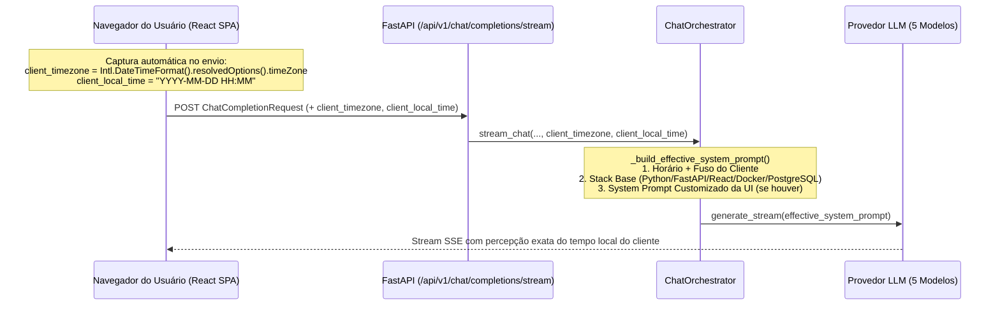

# 📋 Plano Arquitetural (v2) — Injeção Dinâmica de Fuso Horário do Cliente e Stack Padrão

**Projeto:** `RP_ChatBot`  
**Arquivos Alvo:**
- [`frontend/src/services/sse.ts`](file:///c:/Users/rpapl/.gemini/antigravity-ide/scratch/rp_chatbot_ui/frontend/src/services/sse.ts)
- [`backend/app/schemas/chat.py`](file:///c:/Users/rpapl/.gemini/antigravity-ide/scratch/rp_chatbot_ui/backend/app/schemas/chat.py)
- [`backend/app/api/v1/endpoints/chat.py`](file:///c:/Users/rpapl/.gemini/antigravity-ide/scratch/rp_chatbot_ui/backend/app/api/v1/endpoints/chat.py)
- [`backend/app/services/chat_orchestrator.py`](file:///c:/Users/rpapl/.gemini/antigravity-ide/scratch/rp_chatbot_ui/backend/app/services/chat_orchestrator.py)

**Objetivo:** Capturar dinamicamente a data/hora local e o fuso horário exato (IANA Timezone) da máquina de onde o usuário está acessando a SPA React, transmitindo esses metadados no payload de chat para que os 5 provedores de LLM (`OpenAI`, `Anthropic`, `Gemini`, `xAI`, `Qwen`) tenham percepção temporal precisa em qualquer lugar do mundo, mantendo a injeção invisível da stack tecnológica padrão (`Python`, `FastAPI`, `React`, `Docker`, `PostgreSQL`) sem qualquer viés geográfico fixo.  
**Status:** Aguardando Aprovação Formal para Execução

---

## 1. Visão Geral do Fluxo Ponta a Ponta

Em vez de assumir um fuso horário fixo no servidor, a captura passa a ser **Client-Aware** (orientada ao navegador do usuário):



---

## 2. Detalhamento Técnico das Alterações

### 2.1. Pilar 1: Frontend React ([`frontend/src/services/sse.ts`](file:///c:/Users/rpapl/.gemini/antigravity-ide/scratch/rp_chatbot_ui/frontend/src/services/sse.ts))
No cliente SSE (`streamChatCompletion`), capturaremos automaticamente no instante de cada requisição:
1. **`client_timezone`:** Identificador IANA do fuso horário do sistema operacional/navegador via `Intl.DateTimeFormat().resolvedOptions().timeZone` (ex: `"America/Sao_Paulo"`, `"Europe/Lisbon"`, `"America/New_York"`, `"UTC"`).
2. **`client_local_time`:** Data e hora locais já formatadas no relógio da máquina do cliente no padrão ISO legível `YYYY-MM-DD HH:MM`.

```typescript
function getClientTimeContext(): { client_timezone: string; client_local_time: string } {
  const now = new Date();
  const client_timezone =
    Intl.DateTimeFormat().resolvedOptions().timeZone || 'UTC';

  const year = now.getFullYear();
  const month = String(now.getMonth() + 1).padStart(2, '0');
  const day = String(now.getDate()).padStart(2, '0');
  const hours = String(now.getHours()).padStart(2, '0');
  const minutes = String(now.getMinutes()).padStart(2, '0');
  const client_local_time = `${year}-${month}-${day} ${hours}:${minutes}`;

  return { client_timezone, client_local_time };
}
```
Esses dois campos serão incluídos automaticamente no `JSON.stringify({...})` enviado para `POST /api/v1/chat/completions/stream`.

---

### 2.2. Pilar 2: Schemas Pydantic & Endpoint ([`backend/app/schemas/chat.py`](file:///c:/Users/rpapl/.gemini/antigravity-ide/scratch/rp_chatbot_ui/backend/app/schemas/chat.py) e [`backend/app/api/v1/endpoints/chat.py`](file:///c:/Users/rpapl/.gemini/antigravity-ide/scratch/rp_chatbot_ui/backend/app/api/v1/endpoints/chat.py))

1. Em [`backend/app/schemas/chat.py`](file:///c:/Users/rpapl/.gemini/antigravity-ide/scratch/rp_chatbot_ui/backend/app/schemas/chat.py#L17-L24), atualizaremos `ChatCompletionRequest` adicionando os campos opcionais com validação de tamanho:
   ```python
   class ChatCompletionRequest(BaseModel):
       """Request payload for starting a Server-Sent Events chat completion."""
       session_id: uuid.UUID = Field(..., example="8e3be249-e76c-49cc-8e65-ba5a029f3437")
       message: UserMessageInput
       model_name: Optional[str] = Field(default=None, example="GPT-5 (OpenAI)")
       system_prompt: Optional[str] = Field(default=None)
       web_search_mode: Optional[str] = Field(default="auto", pattern="^(auto|always|disabled)$")
       client_timezone: Optional[str] = Field(default=None, max_length=100, example="America/Sao_Paulo")
       client_local_time: Optional[str] = Field(default=None, max_length=64, example="2026-10-28 15:47")
   ```

2. Em [`backend/app/api/v1/endpoints/chat.py`](file:///c:/Users/rpapl/.gemini/antigravity-ide/scratch/rp_chatbot_ui/backend/app/api/v1/endpoints/chat.py#L92-L98), repassaremos `client_timezone=request.client_timezone` e `client_local_time=request.client_local_time` na chamada de `orchestrator.stream_chat(...)`.

---

### 2.3. Pilar 3 & 4: `ChatOrchestrator` Agnóstico de Geografia ([`backend/app/services/chat_orchestrator.py`](file:///c:/Users/rpapl/.gemini/antigravity-ide/scratch/rp_chatbot_ui/backend/app/services/chat_orchestrator.py))

No `ChatOrchestrator`, removeremos qualquer menção fixa a `Europe/Lisbon` ou a Portugal, implementando:

1. **Injeção Invisível da Stack Tecnológica Padrão (Sem Viés Geográfico):**
   ```python
   BASE_TECH_STACK_PROFILE = (
       "Contexto Técnico e Stack Padrão de Desenvolvimento:\n"
       "- A arquitetura padrão do usuário envolve Python, FastAPI, React, Docker e PostgreSQL.\n"
       "- Salvo instrução explícita em contrário na conversa, priorize exemplos de código, "
       "padrões arquiteturais e recomendações técnicas alinhados a essa stack."
   )
   ```

2. **Resolução Resiliente do Horário e Fuso do Cliente em `_build_effective_system_prompt`:**
   - **Prioridade 1 (`client_local_time` + `client_timezone` enviados pelo navegador):** Usa diretamente a hora local da máquina do cliente e seu fuso horário IANA.
   - **Prioridade 2 (Apenas `client_timezone` enviado):** Calcula a hora local correspondente no backend usando `datetime.now(ZoneInfo(client_timezone)).strftime("%Y-%m-%d %H:%M")`.
   - **Fallback Seguro (Chamadas de API diretas sem ambos os campos):** Utiliza `datetime.now(timezone.utc).strftime("%Y-%m-%d %H:%M")` com indicação explícita de `UTC`.

3. **Concatenação Segura com o `system_prompt` do Usuário:**
   ```python
   def _build_effective_system_prompt(
       self,
       user_system_prompt: Optional[str] = None,
       client_timezone: Optional[str] = None,
       client_local_time: Optional[str] = None
   ) -> str:
       """
       Monta o system_prompt efetivo combinando:
       1. Data/hora e fuso horário dinâmicos da máquina do cliente.
       2. Perfil invisível da stack tecnológica padrão (Python, FastAPI, React, Docker, PostgreSQL).
       3. System prompt personalizado configurado pelo usuário na sessão (se houver).
       """
       resolved_tz = (client_timezone or "").strip() or "UTC"
       resolved_time = (client_local_time or "").strip()

       if not resolved_time:
           try:
               tz_obj = ZoneInfo(resolved_tz)
           except (ZoneInfoNotFoundError, Exception):
               tz_obj = timezone.utc
               resolved_tz = "UTC"
           resolved_time = datetime.now(tz_obj).strftime("%Y-%m-%d %H:%M")

       time_info = (
           f"System Info: A data e hora atuais na máquina do usuário são {resolved_time} "
           f"(Fuso horário local: {resolved_tz})."
       )

       base_context = f"{time_info}\n\n{self.BASE_TECH_STACK_PROFILE}"

       if user_system_prompt and user_system_prompt.strip():
           return (
               f"{base_context}\n\n"
               f"--- Instruções Personalizadas da Sessão (Definidas pelo Usuário) ---\n"
               f"{user_system_prompt.strip()}"
           )

       return base_context
   ```

---

## 3. Plano de Execução e Validação Pós-Aprovação

Após sua aprovação técnica deste `plano_injecao_contexto_v2.md`:
1. Removeremos o arquivo antigo `plano_injecao_contexto.md` (se desejado) e aplicaremos as mudanças em [`frontend/src/services/sse.ts`](file:///c:/Users/rpapl/.gemini/antigravity-ide/scratch/rp_chatbot_ui/frontend/src/services/sse.ts), [`backend/app/schemas/chat.py`](file:///c:/Users/rpapl/.gemini/antigravity-ide/scratch/rp_chatbot_ui/backend/app/schemas/chat.py), [`backend/app/api/v1/endpoints/chat.py`](file:///c:/Users/rpapl/.gemini/antigravity-ide/scratch/rp_chatbot_ui/backend/app/api/v1/endpoints/chat.py) e [`backend/app/services/chat_orchestrator.py`](file:///c:/Users/rpapl/.gemini/antigravity-ide/scratch/rp_chatbot_ui/backend/app/services/chat_orchestrator.py).
2. Faremos o rebuild dos containers `rp_backend` e `rp_frontend`.
3. Executaremos testes automatizados simulando clientes em diferentes fusos horários (ex: `America/Sao_Paulo`, `America/New_York`, `Europe/Lisbon`) e validando a preservação do `system_prompt` customizado e da stack padrão.

