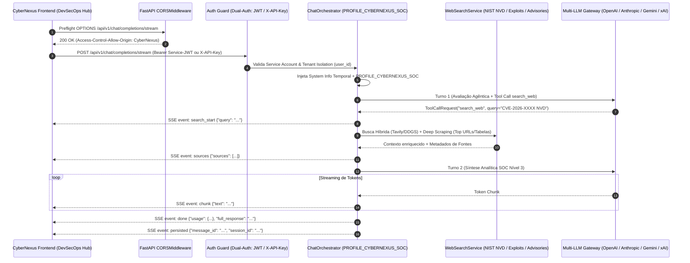

# 🛡️ Plano Arquitetural de Integração Headless: RP_ChatBot ↔ CyberNexus (DevSecOps Hub)

**Documento:** Especificação Técnica e Arquitetural (RFC)  
**Status:** Aguardando Aprovação Técnica (Nenhum código de produção alterado)  
**Autor:** Arquiteto de Software Sênior  
**Data:** Outubro de 2026  

---

## 📋 1. Visão Geral da Arquitetura

O objetivo desta especificação é expor o motor de IA multi-modelo do **RP_ChatBot** (FastAPI + Dual-Turn Agentic Web Search + Two-Tier Semantic Cache) como uma **Headless API** nativa para ser consumida pelo frontend do **CyberNexus** (Hub de DevSecOps e Operações de Segurança).



---

## 🔐 2. Pilar 1: Liberação de CORS e Autenticação (RP_ChatBot Backend)

### 2.1. Atualização do `CORSMiddleware` e Origens Permitidas

Atualmente, o arquivo `backend/app/core/config.py` restringe `CORS_ORIGINS` às portas locais do próprio RP_ChatBot (`5185`, `8085`, `8002`) e ao domínio `https://chat.rpaplaus.com`. Para permitir que o frontend do **CyberNexus** realize requisições cross-origin (incluindo *preflight* `OPTIONS` e conexões persistentes `text/event-stream`), faremos duas adições coordenadas:

#### A. Configuração em `backend/app/core/config.py` e `.env`
Adição das origens de desenvolvimento e produção do CyberNexus na lista `CORS_ORIGINS`, além das variáveis de ambiente dedicadas à integração machine-to-machine (M2M):

```python
# Trecho planejado para: backend/app/core/config.py
class Settings(BaseSettings):
    # ...
    # --- CORS Origins (RP_ChatBot UI + CyberNexus DevSecOps Hub) ---
    CORS_ORIGINS: List[str] = [
        "https://chat.rpaplaus.com",
        "https://cybernexus.rpaplaus.com",      # CyberNexus Produção
        "http://localhost:5185",                # RP_ChatBot Frontend
        "http://localhost:8085",                # RP_ChatBot Caddy Gateway
        "http://localhost:8002",                # RP_ChatBot Backend Direto
        "http://localhost:3000",                # CyberNexus Frontend (Next.js / React)
        "http://localhost:5173",                # CyberNexus Frontend (Vite Default)
        "http://localhost:5190",                # CyberNexus Frontend (Porta Customizada)
        "http://127.0.0.1:5185",
        "http://127.0.0.1:8085",
        "http://127.0.0.1:8002",
        "http://127.0.0.1:3000",
        "http://127.0.0.1:5173",
        "http://127.0.0.1:5190",
    ]

    # --- Service Account & Headless API Integration (CyberNexus) ---
    CYBERNEXUS_API_KEY: Optional[str] = None
    SERVICE_TOKEN_EXPIRE_DAYS: int = 90
```

#### B. Ajuste de Headers no `CORSMiddleware` (`backend/app/main.py`)
Garantir que os cabeçalhos de autenticação (`Authorization`, `X-API-Key`) e de streaming SSE (`Cache-Control`, `X-Accel-Buffering`) estejam explicitamente suportados e expostos:

```python
# Trecho planejado para: backend/app/main.py
app.add_middleware(
    CORSMiddleware,
    allow_origins=settings.CORS_ORIGINS,
    allow_credentials=True,
    allow_methods=["GET", "POST", "PATCH", "DELETE", "OPTIONS"],
    allow_headers=["Authorization", "X-API-Key", "Content-Type", "Accept", "Cache-Control"],
    expose_headers=["Content-Type", "Cache-Control", "X-Accel-Buffering"],
)
```

---

### 2.2. Estratégia de Autenticação Headless (Arquitetura Dual-Auth: Service Account JWT + `X-API-Key`)

O endpoint `POST /api/v1/chat/completions/stream` exige isolamento multi-tenant no PostgreSQL (`ChatSession.user_id == current_user.id`) e rastreabilidade de custos em `TokenUsageLog`. Por outro lado, o fluxo atual de login humano (`access_token` de 15 minutos + `refresh_token` em cookie `HttpOnly` com rotação estrita no Redis) não é ideal para consumo *headless* cross-origin por outro sistema, pois cookies `HttpOnly` enfrentam bloqueios de `SameSite` entre origens distintas e a rotação de 15 minutos exigiria gerenciamento complexo de estado no cliente externo.

**Decisão Arquitetural:** Implementar suporte **Dual-Auth** no dependency injector (`backend/app/api/deps.py`), combinando:

1. **Emissão de *Service Account Token* (JWT de Longa Duração via `POST /api/v1/auth/service-token`):**
   - Endpoint protegido por `Depends(get_current_admin_user)`.
   - Gera um JWT assinado com `HS256` contendo `"type": "service_account"`, `"client": "cybernexus"`, `"sub": str(admin_or_service_user.id)` e validade configurável (`SERVICE_TOKEN_EXPIRE_DAYS`, padrão 90 dias), sem depender de cookie `HttpOnly`.
2. **Validação Nativa de Chave Estática (`x-api-key`) em Tempo Constante:**
   - Caso o CyberNexus envie o header `X-API-Key: <CYBERNEXUS_API_KEY>`, o dependency `get_current_user` valida o segredo via `hmac.compare_digest` (prevenindo *Timing Attacks*) e resolve automaticamente o usuário da conta de serviço (`APP_USER` / conta dedicada) no PostgreSQL.

#### A. Função de Emissão de Token em `backend/app/core/security.py`
```python
# Trecho planejado para: backend/app/core/security.py
def create_service_account_token(
    user_id: uuid.UUID,
    username: str,
    role: str,
    client_name: str = "cybernexus",
    expire_days: Optional[int] = None
) -> Tuple[str, int]:
    """
    Emite um JWT de longa duração (Service Account Token) para integrações Headless (ex: CyberNexus).
    Retorna (encoded_jwt, expires_in_seconds).
    """
    days = expire_days or settings.SERVICE_TOKEN_EXPIRE_DAYS
    expires_delta = timedelta(days=days)
    now = datetime.now(timezone.utc)
    expire = now + expires_delta

    payload = {
        "sub": str(user_id),
        "username": username,
        "role": role,
        "type": "service_account",
        "client": client_name,
        "iat": int(now.timestamp()),
        "exp": int(expire.timestamp()),
        "jti": str(uuid.uuid4())
    }
    token = jwt.encode(payload, settings.SECRET_KEY, algorithm=settings.JWT_ALGORITHM)
    return token, int(expires_delta.total_seconds())
```

#### B. Novo Endpoint em `backend/app/api/v1/endpoints/auth.py`
```python
# Trecho planejado para: backend/app/api/v1/endpoints/auth.py
@router.post(
    "/service-token",
    response_model=ServiceTokenResponse,
    summary="Issue a long-lived Service Account JWT for Headless integrations (e.g. CyberNexus)"
)
async def issue_service_token(
    data: ServiceTokenRequest,
    current_admin: User = Depends(get_current_admin_user)
):
    """
    Emite um Service Account Token (JWT de longa duração) vinculado ao tenant administrador
    para consumo Headless seguro pelo frontend/BFF do CyberNexus.
    """
    token, expires_in = create_service_account_token(
        user_id=current_admin.id,
        username=current_admin.username,
        role=current_admin.role,
        client_name=data.client_name,
        expire_days=data.expire_days
    )
    return ServiceTokenResponse(
        access_token=token,
        token_type="bearer",
        client_name=data.client_name,
        expires_in=expires_in
    )
```

#### C. Atualização do Resolver de Autenticação em `backend/app/api/deps.py`
```python
# Trecho planejado para: backend/app/api/deps.py
import hmac
from fastapi.security import HTTPBearer, HTTPAuthorizationCredentials, APIKeyHeader
from app.core.config import settings

bearer_scheme = HTTPBearer(auto_error=False)
api_key_scheme = APIKeyHeader(name="x-api-key", auto_error=False)

async def get_current_user(
    credentials: Optional[HTTPAuthorizationCredentials] = Depends(bearer_scheme),
    api_key: Optional[str] = Depends(api_key_scheme),
    db: AsyncSession = Depends(get_db)
) -> User:
    """
    Valida autenticação via:
    1. Header 'x-api-key' (Chave de API estática para integração Headless M2M com comparação em tempo constante).
    2. Header 'Authorization: Bearer <token>' (Aceita JWT 'access' padrão ou 'service_account' de longa duração).
    """
    # 1. Fluxo X-API-Key (Service Account Estática)
    if api_key and settings.CYBERNEXUS_API_KEY:
        if hmac.compare_digest(api_key.strip(), settings.CYBERNEXUS_API_KEY.strip()):
            stmt = select(User).where(User.username == settings.APP_USER)
            result = await db.execute(stmt)
            service_user = result.scalar_one_or_none()
            if service_user:
                return service_user
        raise HTTPException(
            status_code=status.HTTP_401_UNAUTHORIZED,
            detail="Chave de API (x-api-key) inválida.",
            headers={"WWW-Authenticate": "ApiKey"}
        )

    # 2. Fluxo Bearer JWT (Access Token de Sessão ou Service Account Token)
    if not credentials or not credentials.credentials:
        raise HTTPException(
            status_code=status.HTTP_401_UNAUTHORIZED,
            detail="Credenciais de autenticação não fornecidas (use Bearer Token ou x-api-key).",
            headers={"WWW-Authenticate": "Bearer"}
        )

    token = credentials.credentials
    try:
        payload = decode_jwt_token(token)
        if payload.get("type") not in ("access", "service_account"):
            raise HTTPException(
                status_code=status.HTTP_401_UNAUTHORIZED,
                detail="Tipo de token inválido para acesso à API.",
                headers={"WWW-Authenticate": "Bearer"}
            )
        user_id = uuid.UUID(payload["sub"])
    except jwt.ExpiredSignatureError:
        raise HTTPException(
            status_code=status.HTTP_401_UNAUTHORIZED,
            detail="Token de acesso expirado.",
            headers={"WWW-Authenticate": "Bearer"}
        )
    except (jwt.PyJWTError, ValueError, KeyError):
        raise HTTPException(
            status_code=status.HTTP_401_UNAUTHORIZED,
            detail="Token de acesso inválido.",
            headers={"WWW-Authenticate": "Bearer"}
        )

    stmt = select(User).where(User.id == user_id)
    result = await db.execute(stmt)
    user = result.scalar_one_or_none()
    if not user:
        raise HTTPException(status_code=status.HTTP_401_UNAUTHORIZED, detail="Usuário não encontrado.")
    return user
```

---

## 🧠 3. Pilar 2: Criação do Perfil CyberNexus SOC (`ChatOrchestrator`)

### 3.1. Validação de Schema (`backend/app/schemas/chat.py`)

O schema Pydantic `ChatCompletionRequest` valida atualmente o campo `profile_id` com a expressão regular `^(software_engineer|general_assistant)$`. Atualizaremos o contrato para aceitar `"cybernexus_soc"`:

```python
# Trecho planejado para: backend/app/schemas/chat.py (Linhas 22-27)
    profile_id: Optional[str] = Field(
        default="software_engineer",
        pattern="^(software_engineer|general_assistant|cybernexus_soc)$",
        example="cybernexus_soc",
        description=(
            "Perfil contextual de comportamento da IA "
            "('software_engineer', 'general_assistant' ou 'cybernexus_soc')."
        )
    )
```

---

### 3.2. Definição do Bloco `PROFILE_CYBERNEXUS_SOC` e Roteamento (`backend/app/services/chat_orchestrator.py`)

No `ChatOrchestrator`, adicionaremos a constante de classe `PROFILE_CYBERNEXUS_SOC` com diretrizes especializadas de **Analista de SOC Nível 3 / Principal DevSecOps Engineer**, mantendo a ferramenta de busca web (`search_web` com *Deep Scraping*) integralmente habilitada para permitir consultas em tempo real ao **NIST NVD**, **CISA KEV**, **MITRE ATT&CK**, **GitHub Security Advisories (GHSA)**, **Exploit-DB** e fóruns de *Threat Intelligence*.

```python
# Trecho planejado para: backend/app/services/chat_orchestrator.py
class ChatOrchestrator:
    # ...
    PROFILE_CYBERNEXUS_SOC = (
        "Diretrizes Operacionais e Contexto Tático (Perfil: CyberNexus SOC Nível 3 & DevSecOps Specialist):\n"
        "- Você está atuando como um Analista de SOC Nível 3 (Tier 3 Incident Responder) e Arquiteto Sênior de DevSecOps "
        "integrado nativamente ao hub CyberNexus.\n"
        "- Sua especialidade abrange Threat Intelligence, caça a ameaças (Threat Hunting), análise forense, correlação de "
        "eventos SIEM/SOAR, segurança de pipelines CI/CD (SAST, DAST, SCA, Container/IaC Security), gestão de CVEs "
        "(NIST NVD, CISA KEV, MITRE ATT&CK, CVSS v3.1/v4.0) e resposta rápida a vulnerabilidades zero-day.\n"
        "- Sempre estruture análises técnicas de vulnerabilidades ou incidentes contendo:\n"
        "  1. **Sumário Executivo e Severidade:** CVE-ID, vetor CVSS, CWE associada e superfície de ataque.\n"
        "  2. **Análise de Exploração (Threat Intel):** Status de exploração ativa (in-the-wild), existência de PoC/Exploits públicos e TTPs (MITRE ATT&CK).\n"
        "  3. **Remediação e Hardening (DevSecOps):** Patches oficiais, regras de detecção (Sigma/YARA/WAF/Suricata) e controles compensatórios imediatos (workarounds) para contenção de zero-days.\n"
        "- Quando a ferramenta `search_web` estiver disponível, utilize-a PROATIVAMENTE para consultar boletins de segurança "
        "em tempo real, bases de CVEs (NIST NVD, MITRE, GitHub Advisories), alertas CISA, fóruns de segurança e repositórios "
        "de exploits, ancorando suas buscas na data atual informada no System Info."
    )
```

#### Atualização de `_build_effective_system_prompt` em `backend/app/services/chat_orchestrator.py`:
Garantimos que, para todos os modelos com suporte a busca web (`supports_web_search=True`, como GPT-5, Claude Sonnet 4.6, Gemini-3 e Grok-4-1), o perfil `cybernexus_soc` carregue o bloco `PROFILE_CYBERNEXUS_SOC` e preserve a capacidade de execução agêntica do `search_web`:

```python
# Trecho planejado para: backend/app/services/chat_orchestrator.py (Linhas 125-138)
        normalized_profile = (profile_id or "software_engineer").strip().lower()

        if not supports_web_search:
            if normalized_profile in ("general_assistant", "cybernexus_soc"):
                logger.info(
                    f"[Profile Guardrail] Code specialist model detected; overriding requested "
                    f"profile '{normalized_profile}' -> BASE_CODE_SPECIALIST_PROFILE."
                )
            profile_block = self.BASE_CODE_SPECIALIST_PROFILE
        elif normalized_profile == "cybernexus_soc":
            profile_block = self.PROFILE_CYBERNEXUS_SOC
        elif normalized_profile == "general_assistant":
            profile_block = self.PROFILE_GENERAL_ASSISTANT
        else:
            profile_block = self.PROFILE_SOFTWARE_ENGINEER
```

---

### 3.3. Isolamento de Partição no Cache Semântico (`backend/app/services/semantic_cache.py`)

> [!IMPORTANT]
> Como o RP_ChatBot possui um motor de **Cache Semântico L1 (Redis) / L2 (pgvector)** que particiona as respostas por `profile_id` (`SemanticCacheService.resolve_effective_profile`), é fundamental registrar `"cybernexus_soc"` como uma partição própria. Isso impede que uma pergunta feita no perfil `"software_engineer"` retorne em cache para o `"cybernexus_soc"` sem o rigor de Threat Intelligence/SOC Nível 3.

```python
# Trecho planejado para: backend/app/services/semantic_cache.py (Linhas 84-95)
    @staticmethod
    def resolve_effective_profile(profile_id: Optional[str], supports_web_search: bool) -> str:
        if not supports_web_search:
            return "code_specialist"
        norm = (profile_id or "software_engineer").strip().lower()
        if norm in ("general_assistant", "cybernexus_soc"):
            return norm
        return "software_engineer"
```

---

## 📡 4. Pilar 3: Contrato de Consumo (CyberNexus Frontend)

### 4.1. Especificação do Protocolo de Eventos SSE (`POST /api/v1/chat/completions/stream`)

O servidor do RP_ChatBot utiliza `StreamingResponse` (`media_type="text/event-stream"`) sobre um método `POST`. Diferente da API nativa `EventSource` do navegador (que suporta apenas `GET` e não permite envio de body JSON nem headers `Authorization`/`X-API-Key`), o cliente TypeScript do CyberNexus deve utilizar a **`fetch` API com `ReadableStream` e `TextDecoder`**.

Os eventos emitidos pelo RP_ChatBot seguem o padrão SSE (`event: <nome>\ndata: <json>\n\n`):

| Evento SSE (`event:`) | Payload JSON (`data:`) | Descrição no Ciclo de Vida SOC |
| :--- | :--- | :--- |
| `search_start` | `{"query": "CVE-2026-... exploit mitigation"}` | Disparado quando o modelo aciona a tool `search_web` para consultar bases de Threat Intel em tempo real. |
| `sources` | `{"query": "...", "total_sources": 5, "sources": [{"index": 1, "title": "...", "url": "...", "snippet": "..."}]}` | Lista consolidada de fontes e advisories raspados (Deep Scraping) antes do início do Turno 2. |
| `chunk` | `{"text": "### 1. Sumário Executivo..."}` | Fragmento incremental de texto Markdown gerado pelo Analista SOC Nível 3. |
| `done` | `{"model": "...", "provider": "...", "sources": [...], "full_response": "...", "cached": false, "usage": {...}}` | Sinaliza conclusão da geração pelo LLM e entrega telemetria de tokens. |
| `persisted` | `{"message_id": "uuid", "model": "...", "session_id": "uuid", "created_at": "ISO-8601"}` | Confirma que a mensagem foi gravada com sucesso no PostgreSQL do RP_ChatBot. |
| `error` | `{"message": "Descrição do erro"}` | Emitido em caso de falha de provedor ou exceção durante o streaming. |

---

### 4.2. Implementação Agnóstica em TypeScript para o CyberNexus Frontend

Abaixo está o módulo cliente completo, tipado e agnóstico de framework (compatível com React, Next.js, Vue, Angular ou Vanilla TS), incluindo criação/reutilização de sessão e consumo do stream SSE com `profile_id: "cybernexus_soc"` e `web_search_mode: "auto"`:

```typescript
/**
 * cybernexus-rpchatbot-client.ts
 * Cliente Headless agnóstico em TypeScript para integração do CyberNexus com o RP_ChatBot.
 */

export type WebSearchMode = "auto" | "always" | "disabled";
export type ChatProfileId = "cybernexus_soc" | "software_engineer" | "general_assistant";

export interface CyberNexusAuthConfig {
  /** URL base do backend do RP_ChatBot (ex: "http://localhost:8002" ou "https://chat.rpaplaus.com") */
  baseUrl: string;
  /** Service Account JWT emitido via POST /api/v1/auth/service-token (Recomendado) */
  serviceBearerToken?: string;
  /** Alternativa: Chave de API estática configurada em CYBERNEXUS_API_KEY */
  apiKey?: string;
}

export interface ChatAttachment {
  file_id?: string;
  filename: string;
  type: "text" | "image" | "audio";
  content: string;
}

export interface CyberNexusStreamRequest {
  sessionId: string;
  prompt: string;
  modelName?: string;
  profileId?: ChatProfileId;
  webSearchMode?: WebSearchMode;
  systemPromptOverride?: string;
  attachments?: ChatAttachment[];
}

export interface WebSourceItem {
  index: number;
  title: string;
  url: string;
  snippet?: string;
}

export interface StreamTokenUsage {
  prompt_tokens: number;
  completion_tokens: number;
  total_tokens: number;
  provider: string;
  model: string;
}

export interface SSEDoneEventPayload {
  model: string;
  provider: string;
  sources: WebSourceItem[];
  full_response: string;
  cached: boolean;
  cache_tier?: "L1_REDIS" | "L2_PGVECTOR";
  similarity?: number;
  usage: StreamTokenUsage;
}

export interface SSEPersistedEventPayload {
  message_id: string;
  model: string;
  session_id: string;
  created_at: string;
}

export interface CyberNexusSSECallbacks {
  onSearchStart?: (query: string) => void;
  onSourcesResolved?: (sources: WebSourceItem[], query: string) => void;
  onChunk: (textDelta: string) => void;
  onDone?: (payload: SSEDoneEventPayload) => void;
  onPersisted?: (payload: SSEPersistedEventPayload) => void;
  onError?: (errorMessage: string) => void;
}

/**
 * Monta os cabeçalhos de autenticação (Bearer Service Token ou X-API-Key).
 */
function buildAuthHeaders(config: CyberNexusAuthConfig): Record<string, string> {
  const headers: Record<string, string> = {
    "Content-Type": "application/json",
  };

  if (config.serviceBearerToken) {
    headers["Authorization"] = `Bearer ${config.serviceBearerToken}`;
  } else if (config.apiKey) {
    headers["X-API-Key"] = config.apiKey;
  } else {
    throw new Error(
      "[CyberNexus AI Client] É necessário fornecer 'serviceBearerToken' ou 'apiKey'."
    );
  }

  return headers;
}

/**
 * Cria uma nova sessão de análise tática no RP_ChatBot vinculada à Service Account do CyberNexus.
 */
export async function createCyberNexusSession(
  config: CyberNexusAuthConfig,
  title: string = "CyberNexus SOC Investigation",
  modelName: string = "Claude Sonnet 4.6"
): Promise<string> {
  const response = await fetch(`${config.baseUrl.replace(/\/$/, "")}/api/v1/sessions`, {
    method: "POST",
    headers: buildAuthHeaders(config),
    body: JSON.stringify({
      title,
      model_name: modelName,
      web_search_mode: "auto",
    }),
  });

  if (!response.ok) {
    const errText = await response.text();
    throw new Error(`Falha ao criar sessão no RP_ChatBot (${response.status}): ${errText}`);
  }

  const sessionData = (await response.json()) as { id: string };
  return sessionData.id;
}

/**
 * Abre a conexão SSE via POST /api/v1/chat/completions/stream com o perfil 'cybernexus_soc'
 * e processa os eventos em tempo real de forma agnóstica.
 */
export async function streamCyberNexusSOCChat(
  config: CyberNexusAuthConfig,
  request: CyberNexusStreamRequest,
  callbacks: CyberNexusSSECallbacks,
  abortSignal?: AbortSignal
): Promise<void> {
  const endpoint = `${config.baseUrl.replace(/\/$/, "")}/api/v1/chat/completions/stream`;

  // Captura fuso horário e relógio local do analista SOC para ancoragem temporal de CVEs/Threat Intel
  const clientTimezone = Intl.DateTimeFormat().resolvedOptions().timeZone || "UTC";
  const now = new Date();
  const clientLocalTime = `${now.getFullYear()}-${String(now.getMonth() + 1).padStart(2, "0")}-${String(
    now.getDate()
  ).padStart(2, "0")} ${String(now.getHours()).padStart(2, "0")}:${String(
    now.getMinutes()
  ).padStart(2, "0")}`;

  // Payload de contrato exigido pelo RP_ChatBot Backend
  const requestBody = {
    session_id: request.sessionId,
    message: {
      content: request.prompt,
      attachments: request.attachments ?? null,
    },
    model_name: request.modelName ?? "Claude Sonnet 4.6",
    profile_id: request.profileId ?? "cybernexus_soc",
    web_search_mode: request.webSearchMode ?? "auto",
    system_prompt: request.systemPromptOverride ?? null,
    client_timezone: clientTimezone,
    client_local_time: clientLocalTime,
  };

  const response = await fetch(endpoint, {
    method: "POST",
    headers: {
      ...buildAuthHeaders(config),
      Accept: "text/event-stream",
      "Cache-Control": "no-cache",
    },
    body: JSON.stringify(requestBody),
    signal: abortSignal,
  });

  if (!response.ok) {
    const errorDetail = await response.text();
    throw new Error(`Erro HTTP ${response.status} ao iniciar stream SSE: ${errorDetail}`);
  }

  if (!response.body) {
    throw new Error("ReadableStream não suportado ou resposta sem corpo.");
  }

  const reader = response.body.getReader();
  const decoder = new TextDecoder("utf-8");
  let buffer = "";

  try {
    while (true) {
      const { value, done } = await reader.read();
      if (done) break;

      buffer += decoder.decode(value, { stream: true });

      // Cada bloco SSE no RP_ChatBot é delimitado por dupla quebra de linha (\n\n)
      const rawEvents = buffer.split("\n\n");
      buffer = rawEvents.pop() ?? ""; // Mantém eventual bloco incompleto no buffer

      for (const rawBlock of rawEvents) {
        const trimmedBlock = rawBlock.trim();
        if (!trimmedBlock) continue;

        let eventType = "message";
        const dataLines: string[] = [];

        for (const line of trimmedBlock.split("\n")) {
          if (line.startsWith("event:")) {
            eventType = line.slice("event:".length).trim();
          } else if (line.startsWith("data:")) {
            dataLines.push(line.slice("data:".length).trim());
          }
        }

        const rawData = dataLines.join("\n");
        if (!rawData) continue;

        let parsedData: any;
        try {
          parsedData = JSON.parse(rawData);
        } catch {
          continue;
        }

        switch (eventType) {
          case "search_start":
            callbacks.onSearchStart?.(parsedData.query);
            break;

          case "sources":
            callbacks.onSourcesResolved?.(
              parsedData.sources ?? [],
              parsedData.query ?? ""
            );
            break;

          case "chunk":
            if (typeof parsedData.text === "string") {
              callbacks.onChunk(parsedData.text);
            }
            break;

          case "done":
            callbacks.onDone?.(parsedData as SSEDoneEventPayload);
            break;

          case "persisted":
            callbacks.onPersisted?.(parsedData as SSEPersistedEventPayload);
            break;

          case "error":
            callbacks.onError?.(parsedData.message ?? "Erro desconhecido no streaming SSE.");
            break;
        }
      }
    }
  } finally {
    reader.releaseLock();
  }
}

// ============================================================================
// Exemplo de Uso no Frontend do CyberNexus
// ============================================================================
/*
const authConfig: CyberNexusAuthConfig = {
  baseUrl: "http://localhost:8002",
  serviceBearerToken: "eyJhbGciOiJIUzI1NiIsInR5cCI6IkpXVCJ9...", // ou apiKey: "cn_live_..."
};

const abortController = new AbortController();

async function analyzeVulnerabilityInSOC() {
  const sessionId = await createCyberNexusSession(authConfig, "Análise CVE Crítica");

  await streamCyberNexusSOCChat(
    authConfig,
    {
      sessionId,
      prompt: "Analise a superfície de exploração e forneça regras de mitigação WAF/Sigma para a CVE mais recente do OpenSSH divulgada no NIST NVD.",
      profileId: "cybernexus_soc",
      webSearchMode: "auto",
      modelName: "Claude Sonnet 4.6",
    },
    {
      onSearchStart: (query) => console.log(`[SOC Threat Intel] Pesquisando na web: ${query}`),
      onSourcesResolved: (sources) => console.log(`[SOC Threat Intel] ${sources.length} fontes NVD/Advisories carregadas:`, sources),
      onChunk: (delta) => process.stdout.write(delta),
      onDone: (summary) => console.log("\n[Concluído] Uso de tokens:", summary.usage),
      onPersisted: (meta) => console.log("[Auditoria] Mensagem persistida com ID:", meta.message_id),
      onError: (err) => console.error("[Alerta de Erro]:", err),
    },
    abortController.signal
  );
}
*/
```

---

## 🗺️ 5. Resumo dos Arquivos Mapeados para Execução (Após Aprovação)

Nenhum arquivo de produção foi alterado nesta etapa. Assim que este plano for aprovado, as modificações serão aplicadas cirurgicamente nos seguintes arquivos:

| Arquivo no Projeto | Tipo de Alteração | Escopo Técnico |
| :--- | :--- | :--- |
| `backend/app/core/config.py` | Atualização | Inclusão das URLs/portas do CyberNexus em `CORS_ORIGINS`, `CYBERNEXUS_API_KEY` e `SERVICE_TOKEN_EXPIRE_DAYS`. |
| `backend/app/main.py` | Atualização | Explicitação dos headers `Authorization`, `X-API-Key` e `expose_headers` no `CORSMiddleware`. |
| `backend/app/core/security.py` | Adição | Função `create_service_account_token()` para emissão de JWTs M2M de longa duração (`type="service_account"`). |
| `backend/app/schemas/auth.py` | Adição | Schemas `ServiceTokenRequest` e `ServiceTokenResponse`. |
| `backend/app/api/v1/endpoints/auth.py` | Adição | Endpoint `POST /api/v1/auth/service-token` restrito a administradores. |
| `backend/app/api/deps.py` | Atualização | Suporte Dual-Auth em `get_current_user` (`Bearer <Service-JWT>` + `X-API-Key` com `hmac.compare_digest`). |
| `backend/app/schemas/chat.py` | Atualização | Inclusão de `cybernexus_soc` na regex de validação de `ChatCompletionRequest.profile_id`. |
| `backend/app/services/chat_orchestrator.py` | Atualização | Criação do bloco `PROFILE_CYBERNEXUS_SOC` e roteamento em `_build_effective_system_prompt` com `search_web` ativo. |
| `backend/app/services/semantic_cache.py` | Atualização | Inclusão de `cybernexus_soc` em `resolve_effective_profile` para isolamento de partição semântica no Redis/pgvector. |
| `.env.example` | Atualização | Documentação da variável `CYBERNEXUS_API_KEY` e `SERVICE_TOKEN_EXPIRE_DAYS`. |

