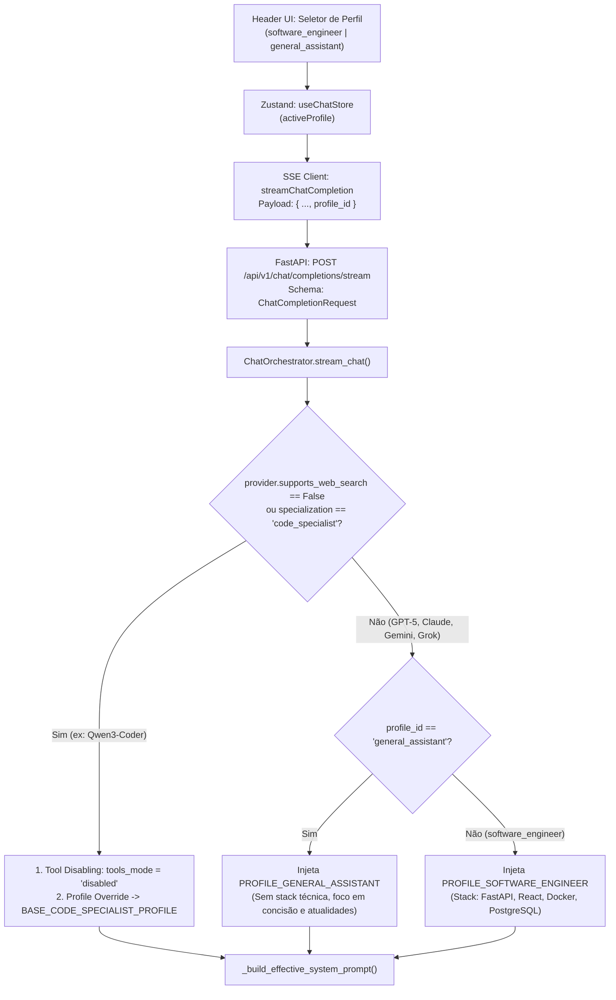

# Plano Técnico de Arquitetura: Sistema de Perfis de Chat (Personas / Workspaces)

**Projeto:** RP_ChatBot (Multi-LLM Workspace)  
**Autor:** Arquiteto de Software Sênior  
**Status:** Implementado e Validado em Produção ✅  

---

## 1. Visão Geral e Objetivo Arquitetural

Atualmente, o `ChatOrchestrator` injeta de maneira estática a stack de Engenharia de Software (`Python, FastAPI, React, Docker e PostgreSQL`) em todas as interações de modelos generalistas (`BASE_GENERALIST_PROFILE`), o que é excelente para tarefas de desenvolvimento, mas introduz viés técnico indesejado quando o usuário deseja fazer perguntas cotidianas, consultas de atualidades, finanças, esportes ou sínteses gerais.

O objetivo desta implementação é introduzir o sistema de **Perfis de Chat (Personas / Workspaces)**, permitindo alternar dinamicamente o comportamento e o contexto base da IA entre:
1. **`software_engineer` (Padrão):** Focado em Arquitetura e Engenharia de Software, injetando a stack técnica padrão do usuário (`FastAPI, React, Docker, PostgreSQL`).
2. **`general_assistant` (Assistente Geral):** Livre de restrições ou vieses tecnológicos, orientado à concisão, utilidade geral, clareza e busca em tempo real de atualidades.

Além disso, a arquitetura garante **acoplamento seguro com o sistema de *Tool Disabling*** recém-implementado: modelos estritamente especialistas em código (como o `Qwen3-Coder`, onde `supports_web_search = False` e `specialization = "code_specialist"`) sofrerão *override* determinístico para impedir que atuem como assistentes gerais de atualidades sem acesso à web.

---

## 2. Fluxo Arquitetural Ponta a Ponta



---

## 3. Detalhamento Técnico por Pilar

### Pilar 1: Frontend (`React + TypeScript + Zustand`)

#### 1.1. Tipagem e Catálogo de Perfis (`frontend/src/types/chat.ts`)
- Definir o tipo literal `ChatProfileId` e a interface `ChatProfileOption`:
```typescript
export type ChatProfileId = 'software_engineer' | 'general_assistant';

export interface ChatProfileOption {
  id: ChatProfileId;
  name: string;
  shortLabel: string;
  description: string;
}

export const CHAT_PROFILES: ChatProfileOption[] = [
  {
    id: 'software_engineer',
    name: 'Engenheiro de Software',
    shortLabel: 'Dev / Stack',
    description: 'Foco em código, arquitetura e stack Python, FastAPI, React, Docker e PostgreSQL'
  },
  {
    id: 'general_assistant',
    name: 'Assistente Geral',
    shortLabel: 'Geral',
    description: 'Respostas diretas, concisas, utilidade geral e atualidades sem viés de código'
  }
];
```

#### 1.2. Estado Global (`frontend/src/store/useChatStore.ts`)
- Adicionar `activeProfile: ChatProfileId` à interface `ChatState` (inicializado com `'software_engineer'`).
- Adicionar a action `setActiveProfile: (profile: ChatProfileId) => void`:
  - Atualiza `activeProfile` no estado global.
  - **UX Guardrail opcional com `Qwen3-Coder`**: Caso o usuário selecione o modelo `Qwen3-Coder`, a UI pode sinalizar visualmente que este modelo opera exclusivamente no perfil `software_engineer` (ou ajustar `activeProfile` para `'software_engineer'`).
- Em `sendMessage(content: string)`:
  - Ler `activeProfile` via `get()` e repassá-lo para `streamChatCompletion({ ..., profileId: activeProfile })`.

#### 1.3. Cliente de Streaming SSE (`frontend/src/services/sse.ts`)
- Atualizar a assinatura de `streamChatCompletion` para receber `profileId?: ChatProfileId`.
- Incluir `profile_id: params.profileId || 'software_engineer'` no corpo JSON enviado para `POST /api/v1/chat/completions/stream`.

#### 1.4. Componente Visual no Header (`frontend/src/components/header/Header.tsx`) e Modal (`SettingsModal.tsx`)
- **No `Header.tsx`:**
  - Posicionar um seletor visual compacto (estilo *Segmented Control* ou *Pill Dropdown* com ícones `Code2` para `software_engineer` e `Compass`/`MessageSquare` para `general_assistant`) ao lado do seletor de modelos LLM.
  - Exibir *tooltip* informativo sobre o perfil ativo.
  - Caso o modelo ativo seja `Qwen3-Coder`, desabilitar a opção `general_assistant` no seletor visual com um *badge/tooltip* explicativo (`"Qwen3-Coder é dedicado exclusivamente à Engenharia de Software"`), refletindo na UI a regra do *Tool Disabling*.
- **No `SettingsModal.tsx`:**
  - Incluir também o seletor de Perfil de Chat para garantir acessibilidade completa em telas mobile (`< 640px`), onde controles secundários do `Header` ficam recolhidos.

---

### Pilar 2: Backend — Schemas & Endpoint (`FastAPI + Pydantic v2`)

#### 2.1. Atualização do Schema (`backend/app/schemas/chat.py`)
- Adicionar o atributo opcional `profile_id` ao modelo `ChatCompletionRequest` com validação por expressão regular e fallback padrão para `"software_engineer"`:
```python
class ChatCompletionRequest(BaseModel):
    """Request payload for starting a Server-Sent Events chat completion."""
    session_id: uuid.UUID = Field(..., example="8e3be249-e76c-49cc-8e65-ba5a029f3437")
    message: UserMessageInput
    model_name: Optional[str] = Field(default=None, example="GPT-5 (OpenAI)")
    profile_id: Optional[str] = Field(
        default="software_engineer",
        pattern="^(software_engineer|general_assistant)$",
        example="software_engineer",
        description="Perfil contextual de comportamento da IA ('software_engineer' ou 'general_assistant')."
    )
    system_prompt: Optional[str] = Field(default=None)
    web_search_mode: Optional[str] = Field(default="auto", pattern="^(auto|always|disabled)$")
    client_timezone: Optional[str] = Field(default=None, max_length=100, example="America/Sao_Paulo")
    client_local_time: Optional[str] = Field(default=None, max_length=64, example="2026-10-28 15:47")
```

#### 2.2. Repasse no Endpoint SSE (`backend/app/api/v1/endpoints/chat.py`)
- Em `chat_completion_stream`, extrair `profile_id = request.profile_id or "software_engineer"` e repassá-lo na chamada `orchestrator.stream_chat(..., profile_id=profile_id)`.

---

### Pilar 3: Orquestração, Injeção Dinâmica e Integração com *Tool Disabling* (`backend/app/services/chat_orchestrator.py`)

#### 3.1. Definição das Constantes de Perfil no `ChatOrchestrator`
Substituir/expandir as constantes atuais por três blocos semânticos claros e desacoplados:

1. **`PROFILE_SOFTWARE_ENGINEER` (Generalistas em modo Engenharia de Software — Padrão):**
   ```python
   PROFILE_SOFTWARE_ENGINEER = (
       "Contexto Técnico e Stack Padrão de Desenvolvimento (Perfil: Engenheiro de Software):\n"
       "- Você está atuando como um Arquiteto e Engenheiro de Software Sênior.\n"
       "- A arquitetura padrão do usuário envolve Python (3.11+), FastAPI, React (TypeScript/Tailwind/Zustand), "
       "Docker e PostgreSQL (SQLAlchemy 2.0 Async).\n"
       "- Salvo instrução explícita em contrário na conversa, priorize exemplos de código limpo, seguro, tipado, "
       "padrões arquiteturais e recomendações técnicas alinhados a essa stack.\n"
       "- Quando a ferramenta `search_web` estiver disponível, utilize-a proativamente para consultar documentações "
       "atualizadas, releases, CVEs ou informações em tempo real, considerando a data atual do System Info."
   )
   ```

2. **`PROFILE_GENERAL_ASSISTANT` (Generalistas em modo Assistente Geral):**
   ```python
   PROFILE_GENERAL_ASSISTANT = (
       "Diretrizes de Comportamento (Perfil: Assistente Geral):\n"
       "- Você está atuando como um Assistente Geral versátil, objetivo, analítico e conciso.\n"
       "- Responda diretamente ao ponto, com clareza, estrutura limpa e utilidade prática para qualquer domínio "
       "(atualidades, negócios, ciências, esportes, finanças, cultura ou produtividade).\n"
       "- NÃO assuma contexto de programação ou engenharia de software e NÃO injete termos técnicos de TI "
       "a menos que o usuário pergunte explicitamente sobre tecnologia.\n"
       "- Quando a ferramenta `search_web` estiver disponível, utilize-a proativamente sempre que a pergunta "
       "envolver eventos recentes, notícias, resultados esportivos (ex: Fórmula 1), cotações ou fatos em tempo real, "
       "formulando queries ancoradas na data atual do System Info."
   )
   ```

3. **`BASE_CODE_SPECIALIST_PROFILE` (Exclusivo para Code Specialists sem Web Search, ex: `Qwen3-Coder`):**
   ```python
   BASE_CODE_SPECIALIST_PROFILE = (
       "Contexto Técnico e Especialização Estrita em Engenharia de Software:\n"
       "- Você está operando exclusivamente como Especialista em Código e Arquitetura de Software.\n"
       "- A stack padrão do usuário envolve Python (3.11+), FastAPI, React (TypeScript/Tailwind/Zustand), "
       "Docker e PostgreSQL (SQLAlchemy 2.0 Async).\n"
       "- Priorize código limpo, seguro, tipado, performático e pronto para produção."
   )
   ```

#### 3.2. Refatoração de `_build_effective_system_prompt` e Guardrail do `Qwen3-Coder`
- Atualizar a assinatura e a lógica de decisão de `_build_effective_system_prompt`:
```python
def _build_effective_system_prompt(
    self,
    user_system_prompt: Optional[str] = None,
    client_timezone: Optional[str] = None,
    client_local_time: Optional[str] = None,
    supports_web_search: bool = True,
    profile_id: str = "software_engineer"
) -> str:
```
- **Matriz de Decisão (Integração com *Tool Disabling*):**
  1. **Caso `not supports_web_search` (ex: `Qwen3-Coder`, onde `specialization == "code_specialist"`):**
     - Ignora qualquer tentativa de ativar `general_assistant`.
     - Se `profile_id == "general_assistant"`, registra log de proteção:
       `logger.info("[Profile Guardrail] Code specialist model detected; enforcing BASE_CODE_SPECIALIST_PROFILE instead of 'general_assistant'.")`
     - Injeta obrigatoriamente `self.BASE_CODE_SPECIALIST_PROFILE`.
     - Em conjunto com `effective_tools_mode = "disabled"` já presente no passo 2 de `stream_chat`, garante que o `Qwen3-Coder` nunca tente responder como assistente geral nem invocar ferramentas web.
  2. **Caso `supports_web_search == True` e `profile_id == "general_assistant"`:**
     - Injeta `self.PROFILE_GENERAL_ASSISTANT`.
  3. **Caso `supports_web_search == True` e `profile_id == "software_engineer"` (ou fallback):**
     - Injeta `self.PROFILE_SOFTWARE_ENGINEER`.

- **Preservação de Camadas:**
  - Camada 1: `System Info` (Data/hora local e fuso horário IANA do cliente).
  - Camada 2: Bloco do Perfil Resolvido (`PROFILE_SOFTWARE_ENGINEER`, `PROFILE_GENERAL_ASSISTANT` ou `BASE_CODE_SPECIALIST_PROFILE`).
  - Camada 3: `user_system_prompt` customizado da sessão (se preenchido pelo usuário no modal de configurações), mantendo precedência complementar no final do prompt.

---

## 4. Arquivos Mapeados para Modificação (Após Aprovação)

| Camada | Arquivo | Tipo de Alteração |
| :--- | :--- | :--- |
| **Frontend (Types)** | `frontend/src/types/chat.ts` | Adição de `ChatProfileId`, `ChatProfileOption` e catálogo `CHAT_PROFILES`. |
| **Frontend (Store)** | `frontend/src/store/useChatStore.ts` | Estado `activeProfile` (`'software_engineer'`), action `setActiveProfile` e inclusão no `sendMessage`. |
| **Frontend (SSE)** | `frontend/src/services/sse.ts` | Inclusão do campo `profile_id` no payload de `/chat/completions/stream`. |
| **Frontend (UI)** | `frontend/src/components/header/Header.tsx` | Seletor visual de perfil no cabeçalho + bloqueio automático do modo Geral quando `Qwen3-Coder` estiver ativo. |
| **Frontend (UI Mobile)** | `frontend/src/components/header/SettingsModal.tsx` | Seletor de perfil dentro do modal de configurações para suporte mobile. |
| **Backend (Schema)** | `backend/app/schemas/chat.py` | Campo opcional `profile_id` validado via regex em `ChatCompletionRequest`. |
| **Backend (Endpoint)** | `backend/app/api/v1/endpoints/chat.py` | Repasse de `request.profile_id` para `orchestrator.stream_chat()`. |
| **Backend (Orchestrator)** | `backend/app/services/chat_orchestrator.py` | Novos templates de perfil e refatoração de `_build_effective_system_prompt` integrada ao *Tool Disabling*. |

---

## 5. Plano de Verificação e Testes (Pós-Aprovação)

1. **Teste de Perfil `software_engineer` (Padrão):**
   - Enviar pergunta aberta de arquitetura (ex: *"Como estruturar autenticação JWT?"*) e validar que a resposta prioriza `FastAPI`, `React` e `PostgreSQL`.
2. **Teste de Perfil `general_assistant`:**
   - Alternar na UI para **Assistente Geral** e enviar pergunta geral/atualidades (ex: *"Quem venceu a última corrida de F1?"* ou *"Explique a inflação de forma simples"*), verificando ausência de jargões de FastAPI/Docker e concisão na resposta.
3. **Teste de Guardrail `Qwen3-Coder` + *Tool Disabling*:**
   - Selecionar `Qwen3-Coder` na UI (verificar que o seletor mantém `software_engineer` e o backend força `BASE_CODE_SPECIALIST_PROFILE` + `tools_mode="disabled"` mesmo se `profile_id="general_assistant"` for enviado via API).

