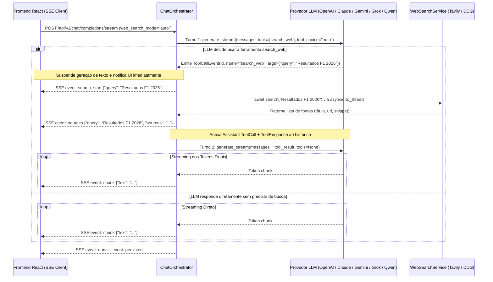

# 📋 Plano Arquitetural — Agentic Tool Calling (Function Calling Nativo Multi-LLM)

**Projeto:** `RP_ChatBot`  
**Arquivos Alvo:**
- `backend/app/services/llm/tools.py` *(Novo — Declarações e Adapters de Tools)*
- [`backend/app/services/llm/base.py`](file:///c:/Users/rpapl/.gemini/antigravity-ide/scratch/rp_chatbot_ui/backend/app/services/llm/base.py)
- [`backend/app/services/llm/openai_provider.py`](file:///c:/Users/rpapl/.gemini/antigravity-ide/scratch/rp_chatbot_ui/backend/app/services/llm/openai_provider.py)
- [`backend/app/services/llm/xai_provider.py`](file:///c:/Users/rpapl/.gemini/antigravity-ide/scratch/rp_chatbot_ui/backend/app/services/llm/xai_provider.py)
- [`backend/app/services/llm/qwen_provider.py`](file:///c:/Users/rpapl/.gemini/antigravity-ide/scratch/rp_chatbot_ui/backend/app/services/llm/qwen_provider.py)
- [`backend/app/services/llm/anthropic_provider.py`](file:///c:/Users/rpapl/.gemini/antigravity-ide/scratch/rp_chatbot_ui/backend/app/services/llm/anthropic_provider.py)
- [`backend/app/services/llm/gemini_provider.py`](file:///c:/Users/rpapl/.gemini/antigravity-ide/scratch/rp_chatbot_ui/backend/app/services/llm/gemini_provider.py)
- [`backend/app/services/web_search.py`](file:///c:/Users/rpapl/.gemini/antigravity-ide/scratch/rp_chatbot_ui/backend/app/services/web_search.py)
- [`backend/app/services/chat_orchestrator.py`](file:///c:/Users/rpapl/.gemini/antigravity-ide/scratch/rp_chatbot_ui/backend/app/services/chat_orchestrator.py)

**Objetivo:** Substituir a decisão heurística baseada em palavras-chave (`should_search` / regex) pelo padrão **Agentic Tool Calling (Function Calling)** nativo dos 5 provedores de LLM (`OpenAI`, `Anthropic`, `Gemini`, `xAI`, `Qwen`), permitindo que o próprio modelo decida autonomamente quando pesquisar na web, formule a query otimizada, aguarde a execução assíncrona da ferramenta e retome o streaming da resposta final mantendo feedback visual em tempo real na UI.  
**Status:** Aguardando Aprovação Técnica para Execução

---

## 1. Visão Geral do Ciclo Agentic (Streaming Duplo)

No modelo heurístico anterior, uma função regex tentava adivinhar se a mensagem precisava de internet antes mesmo de consultar a LLM. Com o **Agentic Tool Calling**, a própria LLM analisa o contexto da conversa (e a data/hora injetada no `system_prompt`) e decide se:
- **Caminho Direto (1 Turno):** Responde imediatamente em streaming se o conhecimento já estiver consolidado.
- **Caminho Agentic (2 Turnos — Streaming Duplo):** Emite uma solicitação estruturada `tool_call: search_web(query="...")`, suspende a geração textual, aguarda o backend executar a busca assíncrona (enquanto o usuário vê no Frontend *"Pesquisando na web em tempo real por 'Resultados F1 2026'..."*), recebe o `tool_response` com os resultados e retoma o streaming com a resposta fundamentada e citada.



---

## 2. Pilar 1: Padronização e Mapeamento Multi-Provedor de Tools

Criaremos o módulo `backend/app/services/llm/tools.py` contendo a definição canônica da ferramenta `search_web` e os adaptadores específicos para as 3 famílias de SDK utilizadas pelos nossos 5 provedores:

### 2.1. Especificação Canônica (`search_web`)
- **Nome da função:** `search_web`
- **Descrição instrucional para o modelo:**
  > *"Pesquisa informações em tempo real na internet (notícias recentes, eventos atuais, resultados esportivos, cotações, documentações atualizadas, lançamentos de tecnologia ou fatos posteriores à data de treinamento). Gere uma query de busca curta, objetiva e otimizada para motores de busca."*
- **Parâmetros JSON Schema:**
  - `query` (`string`, obrigatório): A consulta otimizada formulada pela IA (ex: `"Resultados F1 2026"`, `"Python 3.13 release notes"`).

### 2.2. Mapeamento para cada Família de Provedor

| Família de SDK | Provedores | Formato de Declaração (`tools`) | Formato do Retorno (`tool_response`) no Turno 2 |
| :--- | :--- | :--- | :--- |
| **OpenAI Chat Completions API** | **OpenAI** (`GPT-5`), **xAI** (`Grok 4`), **Qwen** (`Qwen3`) | `[{"type": "function", "function": {"name": "search_web", "description": ..., "parameters": ...}}]` | Mensagem `role: "assistant"` com `tool_calls=[...]` seguida de mensagem `role: "tool"` com `tool_call_id` e `content` (resultados). |
| **Anthropic Messages API** | **Anthropic** (`Claude 4.6`) | `[{"name": "search_web", "description": ..., "input_schema": ...}]` | Mensagem `role: "assistant"` contendo bloco `{"type": "tool_use", "id": ..., "name": "search_web", "input": ...}` seguida de mensagem `role: "user"` contendo bloco `{"type": "tool_result", "tool_use_id": ..., "content": ...}`. |
| **Google GenAI SDK (`google-genai`)** | **Google** (`Gemini 3.1`) | `types.GenerateContentConfig(tools=[types.Tool(function_declarations=[types.FunctionDeclaration(...)])])` | `types.Content(role="model", parts=[types.Part.from_function_call(...)])` seguido de `types.Content(role="user", parts=[types.Part.from_function_response(name="search_web", response={"result": ...})])`. |

### 2.3. Comportamento Respeitando o Seletor `web_search_mode` da UI
O seletor de modo de busca no Header da SPA (`Auto`, `Sempre`, `Off`) passa a controlar diretamente a política de **Tool Choice** enviada à LLM:
- **`web_search_mode == "disabled"` (`Off`):** Nenhuma ferramenta (`tools=None`) é passada ao provedor. A LLM responde 100% com seu conhecimento interno.
- **`web_search_mode == "auto"` (`Auto`):** As ferramentas são habilitadas com `tool_choice="auto"` (ou equivalente no Anthropic/Gemini). A própria LLM decide se precisa ou não chamar `search_web`.
- **`web_search_mode == "always"` (`Sempre`):** No Turno 1, forçamos a invocação da ferramenta (`tool_choice={"type": "function", "function": {"name": "search_web"}}` no OpenAI/xAI/Qwen, `{"type": "tool", "name": "search_web"}` no Anthropic, e `mode="ANY"` no Gemini) para que a própria LLM formule a melhor query de busca possível antes de redigir a resposta no Turno 2!

---

## 3. Pilar 2: Refatoração dos Provedores e do `ChatOrchestrator`

### 3.1. Protocolo de Eventos Internos nos Provedores (`StreamItem`)
Em [`backend/app/services/llm/base.py`](file:///c:/Users/rpapl/.gemini/antigravity-ide/scratch/rp_chatbot_ui/backend/app/services/llm/base.py), atualizaremos a assinatura de `generate_stream` para suportar parâmetros de ferramentas (`tools_mode: str = "disabled"`, `tool_Interaction: Optional[Dict[str, Any]] = None`) e emitir tanto strings de texto quanto um objeto estruturado `ToolCallRequest` quando a LLM solicitar uma ferramenta:

```python
@dataclass
class ToolCallRequest:
    id: str
    name: str
    query: str
    raw_assistant_data: Any = None
```

Como o streaming de argumentos de função chega fragmentado nos SDKs (`delta.tool_calls` na OpenAI/xAI/Qwen e `content_block_delta` do tipo `input_json_delta` na Anthropic):
1. Enquanto o stream envia blocos de texto (`delta.content` / `text_delta`), o provedor faz `yield` imediato da string (latência zero para respostas normais).
2. Se o stream iniciar um bloco de `tool_call` / `tool_use` / `function_call`, o provedor acumula os fragmentos JSON silenciosamente em memória até o fim do bloco (`finish_reason == "tool_calls"` ou fim do stream do Turno 1), faz o parse seguro de `{"query": "..."}` e emite `yield ToolCallRequest(...)`.

### 3.2. Máquina de Estados no `ChatOrchestrator.stream_chat()`
Em [`backend/app/services/chat_orchestrator.py`](file:///c:/Users/rpapl/.gemini/antigravity-ide/scratch/rp_chatbot_ui/backend/app/services/chat_orchestrator.py), substituiremos o bloco estático `if self.search_service.should_search(...)` pelo fluxo **Agentic**:

1. **Início do Turno 1:**
   Chama `provider.generate_stream(..., tools_mode=web_search_mode)`.
2. **Inspeção dos Eventos do Turno 1:**
   - Se vierem `str` (chunks de texto): emite imediatamente `{"event": "chunk", "data": {"text": chunk}}`.
   - Se vier um `ToolCallRequest` (`name == "search_web"`):
     1. Captura `search_query = item.query`.
     2. **Suspensão e Feedback Visual:** Emite imediatamente o evento SSE `{"event": "search_start", "data": {"query": search_query}}`.
     3. **Execução Assíncrona da Ferramenta:** Chama `search_results = await self.search_service.search(search_query)` (que executa Tavily/DuckDuckGo em `asyncio.to_thread`).
     4. Formata o resultado para o modelo (`tool_output_text = self.search_service.format_search_context(search_results)`) e os metadados de fontes (`sources_metadata = self.search_service.format_sources_metadata(search_results, search_query)`).
     5. **Entrega das Fontes à UI:** Emite imediatamente o evento SSE `{"event": "sources", "data": sources_metadata}`.
     6. **Retomada (Turno 2 de Streaming):** Invoca novamente `provider.generate_stream(...)` passando o contexto da chamada de ferramenta (`tool_interaction={"call": item, "output": tool_output_text}`) e `tools_mode="disabled"` para que a LLM sintetize a resposta final em streaming (`event: chunk`).

> [!TIP]
> **Fallback de Alta Disponibilidade:** Se algum modelo ou endpoint retornar erro de incompatibilidade com `tool_choice` forçado no modo `"always"`, o orquestrador captura a exceção de forma transparente, executa a busca com `extract_search_query` e prossegue com o Turno 2 sem interromper a experiência do usuário.

---

## 4. Pilar 3: Streaming Duplo e Feedback Visual no Frontend

Graças ao desenho desacoplado de eventos SSE que implementamos na Fase 4 e Fase 5 ([`frontend/src/services/sse.ts`](file:///c:/Users/rpapl/.gemini/antigravity-ide/scratch/rp_chatbot_ui/frontend/src/services/sse.ts), [`frontend/src/store/useChatStore.ts`](file:///c:/Users/rpapl/.gemini/antigravity-ide/scratch/rp_chatbot_ui/frontend/src/store/useChatStore.ts) e [`frontend/src/components/chat/SearchIndicator.tsx`](file:///c:/Users/rpapl/.gemini/antigravity-ide/scratch/rp_chatbot_ui/frontend/src/components/chat/SearchIndicator.tsx)):

1. **Fase 1 do Stream (Tool Call Detectado):**
   Assim que a LLM emite o `ToolCallRequest(query="Resultados F1 2026")`, o backend dispara via SSE:
   ```text
   event: search_start
   data: {"query": "Resultados F1 2026"}
   ```
   O componente [`SearchIndicator.tsx`](file:///c:/Users/rpapl/.gemini/antigravity-ide/scratch/rp_chatbot_ui/frontend/src/components/chat/SearchIndicator.tsx#L32-L38) exibe instantaneamente o spinner animado:
   `🔄 Pesquisando na web em tempo real por "Resultados F1 2026"...` (mostrando exatamente a query inteligente criada pela LLM, e não mais a pergunta bruta do usuário!).
2. **Transição (Tool Execution Concluída):**
   Quando `await self.search_service.search(...)` retorna, o backend dispara:
   ```text
   event: sources
   data: {"query": "Resultados F1 2026", "total_sources": 5, "sources": [...]}
   ```
   A UI troca o spinner pelo painel expansível com os 5 cards clicáveis das fontes encontradas.
3. **Fase 2 do Stream (Síntese da LLM com `tool_response`):**
   A LLM recebe o `tool_response` e começa a transmitir a resposta final. Cada token gera `event: chunk`, preenchendo o balão de mensagem abaixo dos cards de fontes em tempo real até o `event: done` e `event: persisted`.

---

## 5. Plano de Execução e Validação Pós-Aprovação

Após sua aprovação formal deste `plano_tool_calling.md`:
1. Criaremos `backend/app/services/llm/tools.py` com as definições de schema e helpers de formatação para OpenAI/xAI/Qwen, Anthropic e Gemini.
2. Atualizaremos `base.py` e os 5 provedores (`openai_provider.py`, `xai_provider.py`, `qwen_provider.py`, `anthropic_provider.py`, `gemini_provider.py`) para suportar Function Calling em streaming e envio do `tool_response`.
3. Refatoraremos `ChatOrchestrator.stream_chat()` em `backend/app/services/chat_orchestrator.py` para operar com o ciclo Agentic de Streaming Duplo.
4. Faremos o rebuild do container `rp_backend` e executaremos uma suíte de testes automatizados (`test_tool_calling.py`) validando:
   - Pergunta conceitual em modo `auto` -> LLM responde direto **sem** disparar `search_web`.
   - Pergunta sobre evento atual/2026 em modo `auto` -> LLM invoca `search_web` autonomamente, emite `search_start` com query otimizada, emite `sources` e responde no Turno 2 citando as fontes `[1]`, `[2]`.

